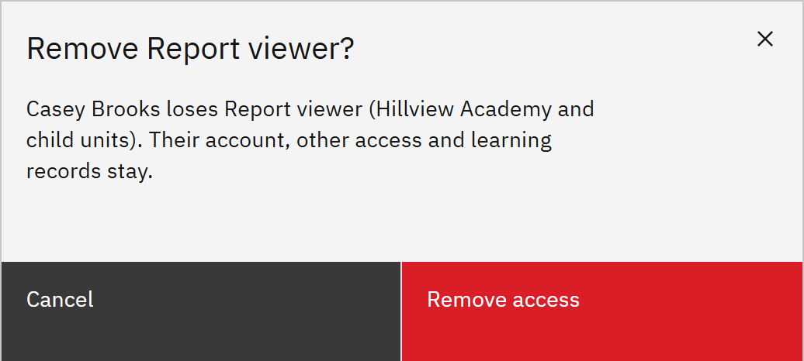

# Remove someone's access

Take one role away from a person. They keep their account, their other roles and their learning records.

You need the **Organisation administrator** role.

1. Find the access

   Go to **Manage** → **Access and permissions**. In **Who has access**, search for the person or filter by **Role**.

2. Remove it

   Click the remove icon at the end of the row. The confirmation names the role and where it applies. Click **Remove
   access**. The **Access removed** message confirms it.

   

   Line manager rows have no remove icon. To end someone's line manager access, change who reports to them. See
   [Set a line manager](./07-set-a-line-manager.md). To stop someone using the platform at all, disable their account
   instead. See [Disable or re-enable an account](./08-disable-or-re-enable-an-account.md).
