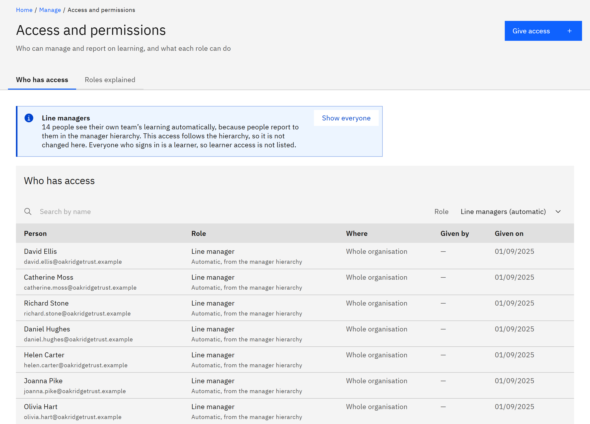

# Check who has line manager access

Line managers see the learning of the people who report to them, and of everyone below those people. You don't give this
access; it follows the manager hierarchy.

You need the **Organisation administrator** role.

1. List the line managers

   Go to **Manage** → **Access and permissions**. The **Line managers** note says how many people see their team
   automatically. Click **Show line managers**. Each row says **Automatic, from the manager hierarchy**.

   

2. Know where the hierarchy comes from

   A person's line manager comes from your HR system, if TMRW support has switched on line managers from HR for your
   organisation. Otherwise, an administrator sets it in **People**. You can see a person's line manager in **People** →
   **View details** → **Employment**.

3. Change it at the source

   To give or take away someone's line manager access, change who reports to them. If the manager comes from HR, change it
   in HR and it's updated at the next sync. If it doesn't come from HR, see [Set a line manager](./07-set-a-line-manager.md).

   Line managers can't change anything. They can only see and export their own team's learning. A line manager whose
   account is disabled loses their access, and their team's escalation emails aren't sent until they're replaced.
