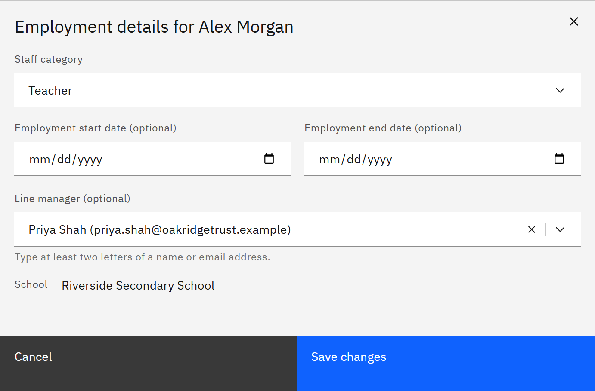

# Set a line manager

Set who a person reports to. The manager then sees that person's learning in **My team**, and can receive manager
escalation emails about them.

You need the **Organisation administrator** role, or the **Learning manager** role given for the whole organisation.

1. Open the person's details

   Go to **Manage** → **People**. Find the person, open the **⋯** menu on their row and choose **View details**.

2. Edit their employment details

   In the **Employment** section, click **Edit employment details**.

   If the section says **Maintained by your HR integration** and there's no **Edit employment details** button, the
   person's employment details and manager come from HR. If the form says **Line manager maintained by your HR
   integration**, the manager comes from HR and updates with each HR sync. Either way, change it in HR instead.

3. Choose the manager

   In **Line manager (optional)**, type at least two letters of the manager's name or email and choose them. To remove a
   manager, clear the field.

   

4. Save

   Click **Save changes**. The manager gets line manager access to this person automatically, and loses it again if the
   person no longer reports to them.
