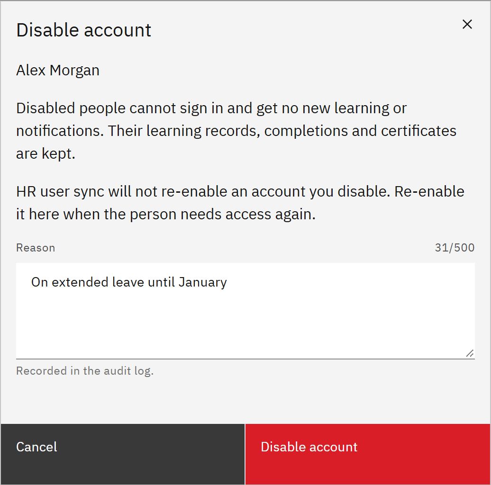

# Disable or re-enable an account

Disable an account to stop someone signing in, for example while they're away or after they've left. Their learning
records, completions and certificates are kept, and you can re-enable the account at any time.

You need the **Organisation administrator** role, or the **Learning manager** role given for the whole organisation. You
can't disable your own account.

1. Find the person

   Go to **Manage** → **People**. To find someone who is already disabled, set **Status** to **Disabled** or **All,
   including disabled**.

2. Choose the action

   Open the **⋯** menu on their row and choose **Disable account** or **Re-enable account**. You can also do this from
   **View details** → **Account**.

3. Give a reason and confirm

   Enter a **Reason**. It's recorded in the audit log. Click **Disable account** or **Re-enable account**.

   

   > **Note:** A disabled person can't sign in, gets no new learning or emails, and drops out of team views and, by
   > default, reports. Their open mandatory learning from learning rules may be withdrawn.

4. Know how HR sync treats it

   If your organisation uses the HR integration, HR sync never re-enables an account you disabled. If HR sync disabled
   the account because the person is no longer in HR, and you re-enable it, the next complete HR sync disables it again
   unless HR lists them by then. People that HR sync disabled are re-enabled automatically when they come back in HR.
