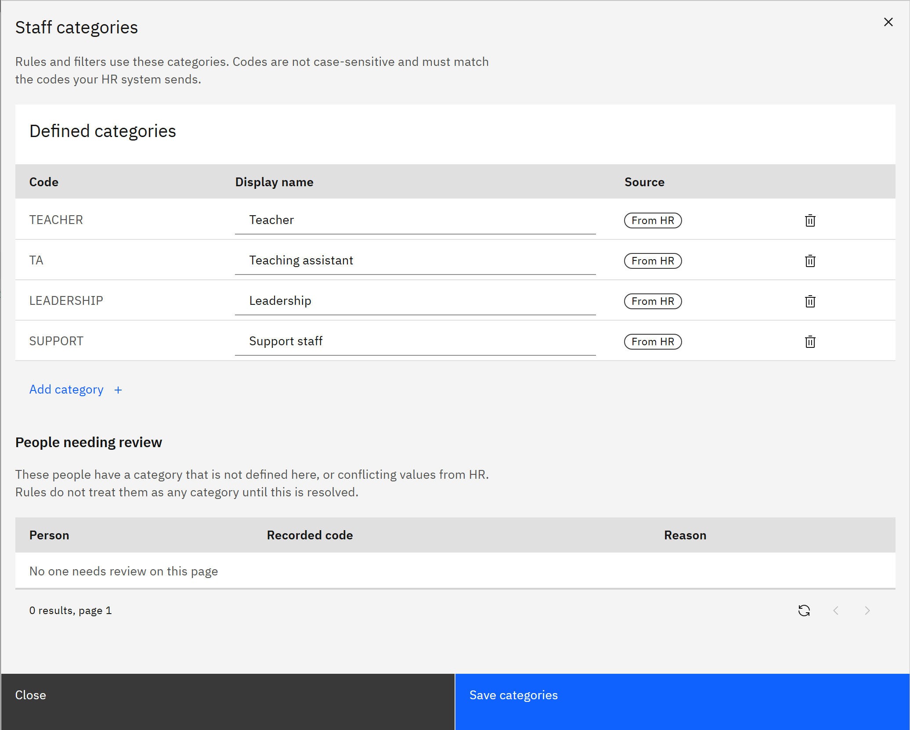

# Manage staff categories

Staff categories, such as Teacher, Teaching assistant, Leadership and Support staff, group people for learning rules,
filters and reports. Each category has a code, which must match the code your HR system sends, and a display name.

You need the **Organisation administrator** role to change categories. A **Learning manager** given for the whole
organisation can view them.

1. Open Staff categories

   Go to **Manage** → **People** and click **Staff categories**. The **Defined categories** table lists each code, its
   display name and where it came from: **From HR** or **Added by admin**.

   

2. Add or rename a category

   Click **Add category** and enter the **Code** and display name. To rename a category, change its display name.
   Codes aren't case-sensitive. A category that came from HR keeps its code exactly as HR sends it, and you can only
   change its name.

3. Remove a category you no longer need

   Click the remove icon on its row. Categories are never removed automatically. A category HR stopped sending shows
   **Not in the latest HR sync**. If HR sends it again, the next complete HR sync adds it back.

4. Save

   Click **Save categories**. Learning rules use the new list straight away.

5. Check people needing review

   **People needing review** lists people whose category isn't defined here, or who have conflicting categories from HR.
   Learning rules don't treat them as any category until this is resolved, so add the missing code or fix the value in HR.

   If your organisation uses the HR integration, the categories HR sends are added automatically after each complete HR
   sync, named from the code. You can hold up to 500 categories.
