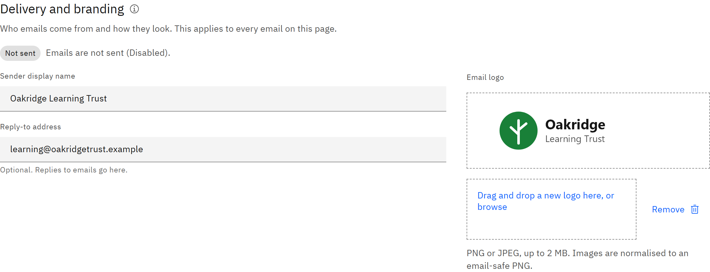

# Set the email sender and logo

Choose who the platform's emails come from and the logo they carry. These settings apply to every email the platform
sends to learners and managers.

You need the **Organisation administrator** role.

1. Open Notifications

   Go to **Manage** → **Notifications**. **Delivery and branding** is the first section.

   

2. Check delivery

   The tag shows where emails go in this environment: **Sending** means they reach the people they're for; **Test
   inbox** and **Not sent** are for test environments; **Not set up** means emails aren't sent. If you see **Emails are
   switched off for your organisation**, no emails on the page are sent. Contact TMRW support to switch them on.

3. Set the sender

   Enter the **Sender display name**, for example "Oakridge Learning". The **Reply-to address** is optional. When you set
   one, replies to the platform's emails go there.

4. Add your logo

   Drag a PNG or JPEG of up to 2 MB onto **Email logo**, or browse for it. It's converted to an email-safe PNG. Click
   **Remove** to go back to the default logo.

5. Save

   Click **Save changes** at the top of the page. One save applies everything on the Notifications page, including the
   logo. If you try to leave with unsaved changes, the platform asks first.
