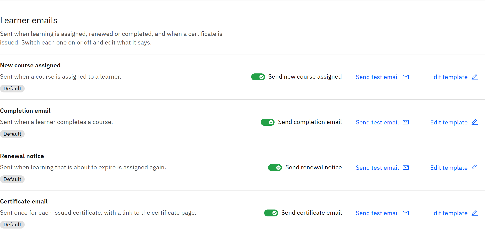

# Choose which learner emails are sent

Learner emails are sent when something happens to a learner's learning. Switch each one on or off for your whole
organisation.

You need the **Organisation administrator** role.

1. Open Learner emails

   Go to **Manage** → **Notifications** and find **Learner emails**.

   

2. Switch emails on or off

   | Email | When it's sent |
   |---|---|
   | **New course assigned** | When a course is assigned to a learner |
   | **Completion email** | When a learner completes a course |
   | **Renewal notice** | When learning that's about to expire is assigned again |
   | **Certificate email** | Once for each certificate issued, with a link to the certificate page |

   A **Customised** tag means the wording has been changed from the default. To change it, click **Edit template**. See
   [Edit an email template](./06-edit-an-email-template.md).

3. Save

   Click **Save changes** at the top of the page.

   Reminders, overdue notices, manager escalations and feedback reminders are set in their own sections on the same page.
   See [Set up learning reminders](./03-set-up-learning-reminders.md).
