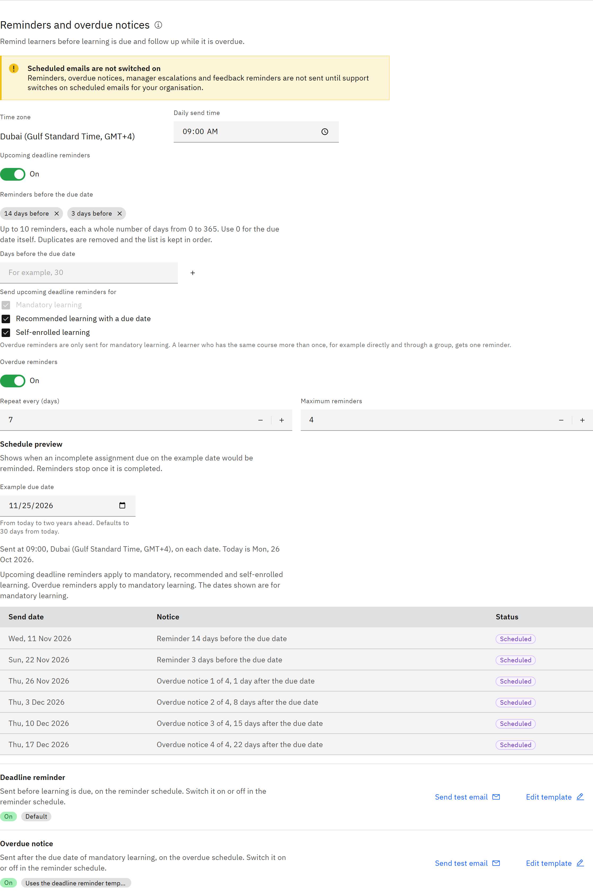

# Set up learning reminders

Remind learners before their learning is due, and follow up while mandatory learning is overdue. Reminders are checked
once a day at your send time, in your organisation's time zone.

You need the **Organisation administrator** role.

1. Open the reminder settings

   Go to **Manage** → **Notifications** and find **Reminders and overdue notices**.

   If you see **Scheduled emails are not switched on**, no reminders, overdue notices, manager escalations or feedback
   reminders are sent yet. You can still set them up here. Contact TMRW support to switch on scheduled emails for your
   organisation.

2. Set the send time

   **Time zone** shows your organisation's time zone. If it's wrong, contact TMRW support. Set the **Daily send time**.
   A day that's missed isn't sent late.

3. Set upcoming deadline reminders

   Turn on **Upcoming deadline reminders**. Under **Reminders before the due date**, add up to 10 reminders by entering
   **Days before the due date** and clicking **Add another**. The default is 14 days and 3 days before. Mandatory learning
   is always reminded. Also tick **Recommended learning with a due date** or **Self-enrolled learning** if you want those
   reminded too. A learner who has the same course more than once, for example directly and through a group, gets one
   reminder.

   

4. Set overdue reminders

   Turn on **Overdue reminders**, then set **Repeat every (days)** (1–30, default 7) and **Maximum reminders** (1–20,
   default 4). Overdue reminders are only sent for mandatory learning, because recommended learning is never overdue.

5. Check the preview

   Under **Schedule preview**, change **Example due date** to see the dates each reminder would be sent.

6. Save

   Click **Save changes** at the top of the page. The **Deadline reminder** and **Overdue notice** emails below the
   schedule show **On** or **Off** to match. To change their wording, click **Edit template**.

   To tell line managers about learning that stays overdue, see
   [Turn on manager escalation](./04-turn-on-manager-escalation.md).
