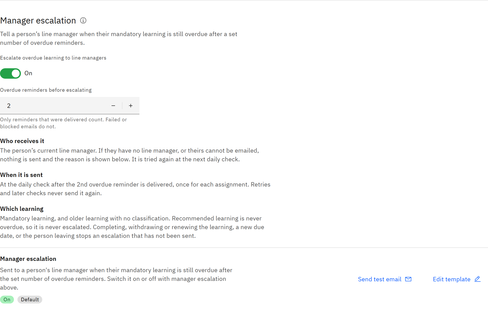

# Turn on manager escalation

Manager escalation emails a person's line manager when their mandatory learning is still overdue after a set number of
overdue reminders. It's off until you turn it on.

You need the **Organisation administrator** role.

1. Check overdue reminders are on

   Escalation counts overdue reminders, so **Overdue reminders** must be on. See
   [Set up learning reminders](./03-set-up-learning-reminders.md). Scheduled emails must also be switched on for your
   organisation. If you see **Scheduled emails are not switched on**, contact TMRW support.

2. Turn on escalation

   Go to **Manage** → **Notifications** and find **Manager escalation**. Turn on **Escalate overdue learning to line
   managers**.

   

3. Set the threshold

   In **Overdue reminders before escalating**, enter a number from 1 to 10. The default is 2. Only reminders that were
   delivered count; failed or blocked emails don't.

   > **Note:** Once this is saved, line managers are emailed about real people's overdue learning at the next daily
   > check.

4. Check who gets it and when

   The email goes to the person's current line manager, the same manager who sees them in **My team**. It's sent at the
   daily check after the threshold is reached, once for each assignment. It covers mandatory learning and older learning
   with no classification. Completing, withdrawing or renewing the learning, a new due date, or the person leaving stops
   an escalation that hasn't been sent yet.

5. Save

   Click **Save changes** at the top of the page. To change the email's wording, click **Edit template** on the
   **Manager escalation** email in this section.

6. Check the last daily check

   **Last daily check** shows how many escalations were sent and why any weren't, for example **No line manager
   recorded** or **Manager has no email address**. Escalations that weren't sent are tried again at the next daily check.
   To fix a missing manager, see [Set a line manager](../12-Access-and-permissions/07-set-a-line-manager.md).
