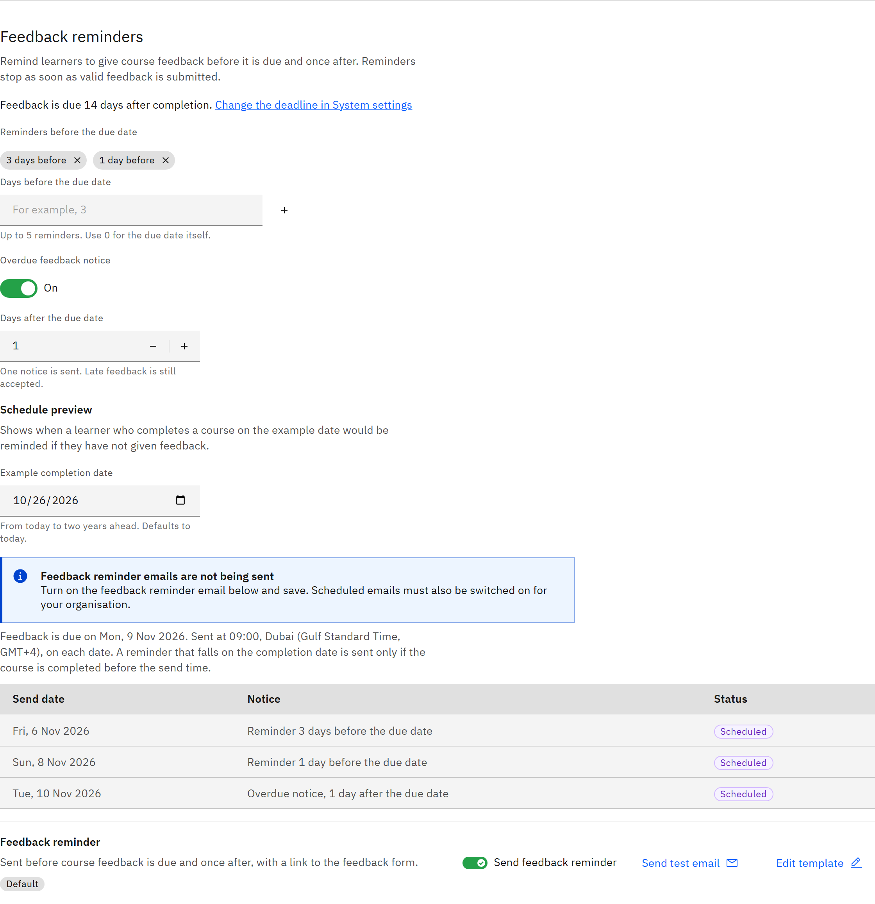

# Set feedback reminders

Remind learners to give course feedback before it's due, and once after. Reminders stop as soon as the learner submits
valid feedback.

You need the **Organisation administrator** role.

1. Check there's a feedback deadline

   Go to **Manage** → **Notifications** and find **Feedback reminders**. If it says **There is no feedback deadline, so no
   feedback reminders are sent**, click **Set a feedback deadline in System settings** first. See
   [Set course feedback rules](./08-set-course-feedback-rules.md).

2. Set reminders before the deadline

   Under **Reminders before the due date**, enter **Days before the due date** and click **Add another**. You can have up
   to 5. The default is 3 days and 1 day before.

   

3. Set the overdue notice

   Turn on **Overdue feedback notice** and set **Days after the due date** (1–30). One notice is sent, and late feedback
   is still accepted.

4. Check the preview and the email

   Use the **Schedule preview** with an **Example completion date** to see when reminders would be sent. Make sure the
   **Feedback reminder** email below is switched on.

5. Save

   Click **Save changes** at the top of the page. Scheduled emails must be switched on for your organisation for feedback
   reminders to be sent. If you see **Scheduled emails are not switched on** on the page, contact TMRW support.
