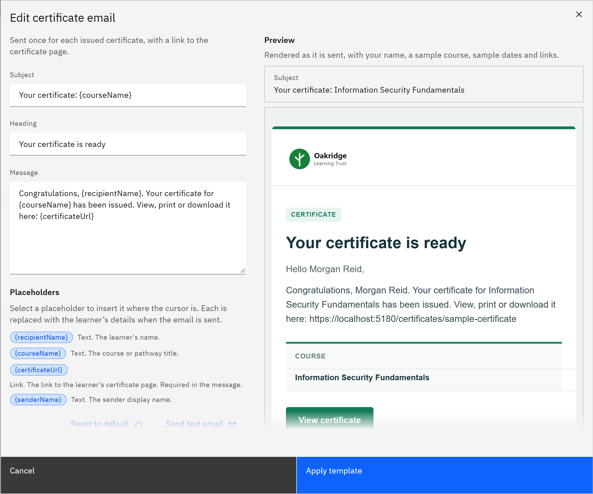

# Edit an email template

Change what an email says. Placeholders such as `{courseName}` are replaced with each person's details when the email is
sent.

You need the **Organisation administrator** role.

1. Open the template

   Go to **Manage** → **Notifications**. Find the email in its section and click **Edit template**.

2. Change the wording

   Edit the **Subject** (up to 160 characters), **Heading** (up to 120) and **Message** (up to 2,000). To insert a
   placeholder, put the cursor where you want it and click the placeholder under **Placeholders**. Some emails need a
   placeholder in the message: the link to the certificate, the feedback form or the person's learning. These are marked
   **Required in the message**.

   

3. Use placeholders

   Each email offers only the placeholders that make sense for it.

   | Placeholder | Replaced with | Used in |
   |---|---|---|
   | `{recipientName}` | The learner's name | Learner emails, reminders |
   | `{courseName}` | The course or pathway title | All emails |
   | `{dueDate}` | The due date, in your organisation's time zone | Assignment, reminders, renewal, feedback, escalation |
   | `{days}` | The number of days before or after the due date | Reminders, feedback reminder |
   | `{timing}` | When it's due, for example "is due in 14 days" or "is 3 days overdue" | Reminders, feedback reminder |
   | `{senderName}` | The sender display name | All emails |
   | `{certificateUrl}` | The link to the learner's certificate page | Certificate email (required) |
   | `{feedbackUrl}` | The link to the course feedback form | Feedback reminder (required) |
   | `{managerName}` | The line manager's name | Manager escalation |
   | `{learnerName}` | The person whose learning is overdue | Manager escalation |
   | `{daysOverdue}` | How many days the learning is overdue | Manager escalation |
   | `{remindersSent}` | How many overdue reminders the person has been sent | Manager escalation |
   | `{teamMemberUrl}` | The link to the person's learning in My team | Manager escalation (required) |

4. Check the preview

   **Preview** shows the email with your logo, as it will look. To see it in your own inbox, click **Send test email**.

5. Apply and save

   Click **Apply template**, then **Save changes** at the top of the page. The email is tagged **Customised**. To go
   back to the original wording, open the template again and click **Reset to default**.

   The **Overdue notice** uses the **Deadline reminder** wording until you customise it. Its button is **Use deadline
   reminder template** instead of **Reset to default**.
