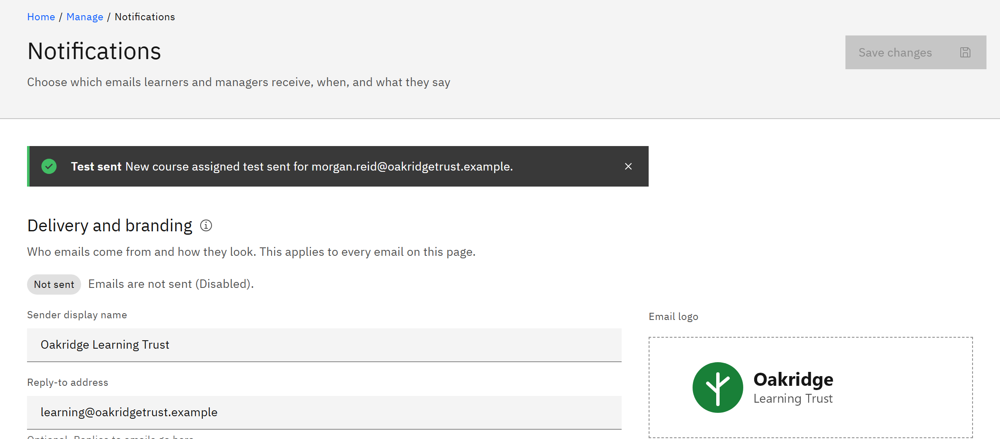

# Send a test email

Send yourself a copy of any email to check its wording and look. The test uses the wording on the page, even if you
haven't saved it yet.

You need the **Organisation administrator** role.

1. Find the email

   Go to **Manage** → **Notifications** and find the email in its section.

2. Send the test

   Click **Send test email** on the email's row, or inside **Edit template**. The message **Test sent** says who it was
   sent to: always you, the signed-in administrator, never a learner.

   

3. Check your inbox

   If the **Delivery and branding** tag says **Not sent** or **Not set up**, the test isn't delivered. If it says **Test
   inbox**, it goes to the environment's test inbox instead of yours. **Test not sent** gives the reason.
