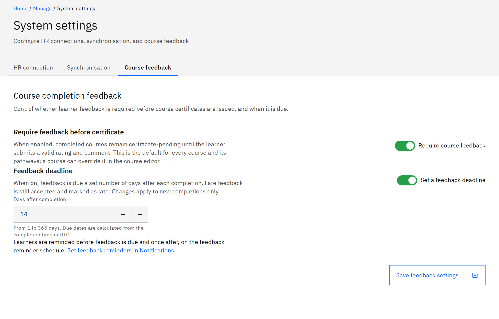

# Set course feedback rules

Decide, for your whole organisation, whether learners must give feedback before they get a certificate, and when
feedback is due. A course can override the certificate rule in its own settings.

You need the **Organisation administrator** role.

1. Open Course feedback

   Go to **Manage** → **Settings** and open the **Course feedback** tab.

   

2. Require feedback before certificates

   Turn on **Require feedback before certificate** to hold each certificate until the learner submits a valid rating and
   comment. This is the default for every course and its pathways.

3. Set a deadline

   Turn on **Feedback deadline** and enter **Days after completion** (1 to 365). Late feedback is still accepted and
   marked as late. A change applies to new completions only.

4. Save

   Click **Save feedback settings**. To remind learners before and after the deadline, click **Set feedback reminders in
   Notifications**. See [Set feedback reminders](./05-set-feedback-reminders.md).

   The other **Settings** tabs, **HR connection** and **Synchronisation**, are for the HR integration. See
   [How the HR integration works](../14-HR-integration/01-how-the-hr-integration-works.md).
