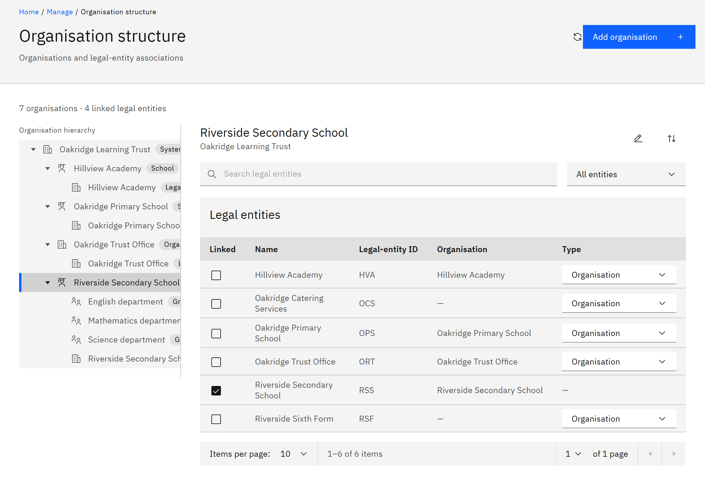
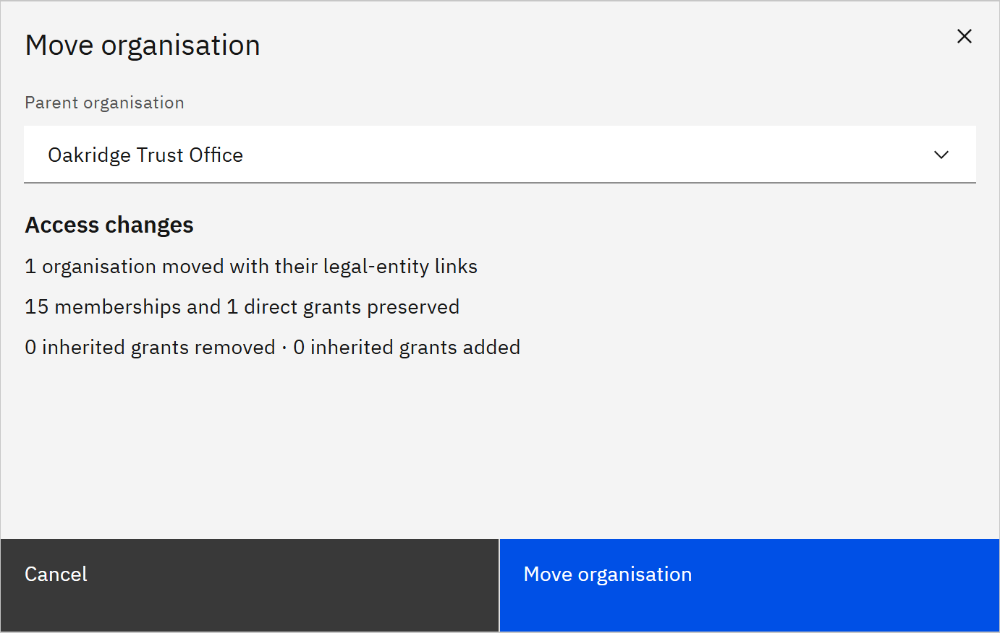

# Manage the organisation structure

The organisation structure is the tree of units, such as your trust, its groups and its schools, that the platform
uses to scope access, reports and learning rules. You decide the shape and what each unit is called.

You need the **Organisation administrator** role to change the structure. Learning managers and report viewers given
access for the whole organisation can view it.

1. Open the structure

   Go to **Manage** → **Organisation structure**. The **Organisation hierarchy** tree is on the left, with each unit's
   type beside its name. Select a unit to see its details and linked legal entities on the right.

   

2. Rename a unit or change its type

   Select the unit and click **Edit organisation**. Change the **Name** or the **Type** (**Organisation**, **Group**,
   **Cluster**, **School**, **Classroom**, or **Custom** with your own type), then click **Save changes**. Types are
   labels only, and don't limit what can sit under a unit. Learning rules and reports use **School** to recognise
   schools.

3. Move a unit

   Select the unit and click **Move organisation**. Choose the new **Parent organisation** and click **Review move**. The
   review shows how many units move with it, the memberships and grants that are kept, and any access people gain or
   lose because of the move. Click **Move organisation** to confirm.

   

   Moving a unit changes access that comes from the units above it. A learning manager given a parent unit with child
   units included gains or loses the moved unit. Check the review before you confirm.

   If you see **Read-only**, organisation changes are switched off for your organisation. Contact TMRW support.
