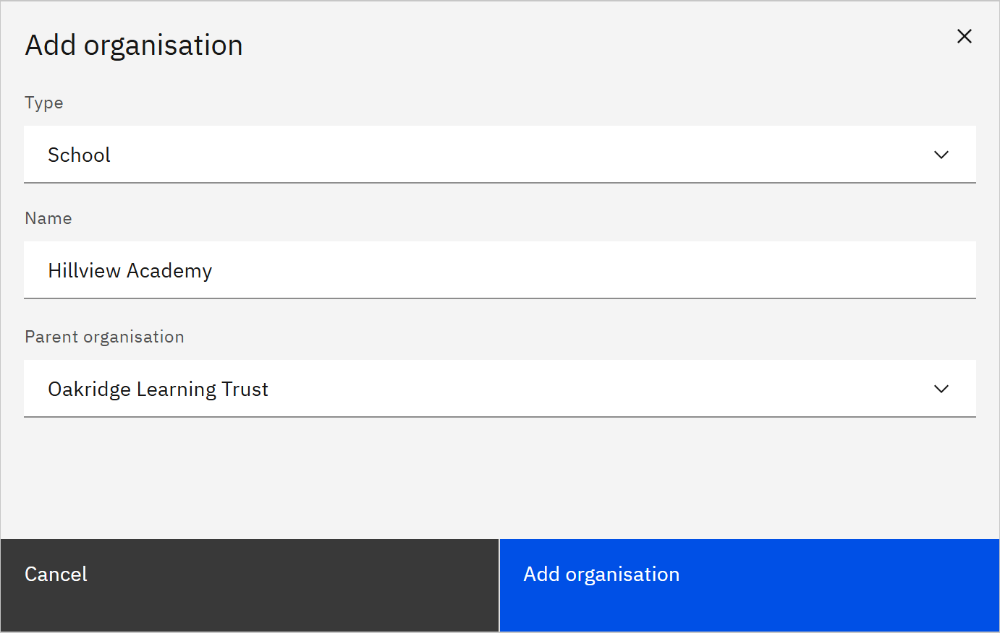

# Add an organisation

Add a unit, such as a school, a group of schools or a head office, to your organisation structure.

You need the **Organisation administrator** role.

1. Start adding

   Go to **Manage** → **Organisation structure** and click **Add organisation**.

2. Fill in the details

   Choose the **Type**, for example **School**. For a type that isn't listed, choose **Custom** and enter a **Custom
   type** in lower-case letters, digits or hyphens. Enter the **Name**, then choose the **Parent organisation** it sits
   under.

   

3. Add it

   Click **Add organisation**. It appears in the tree. To put people in it, add them in **People** with **Add to an
   organisation**, or link it to a legal entity from your HR system so people are placed automatically. See
   [Link legal entities to an organisation](./11-link-legal-entities-to-an-organisation.md).
