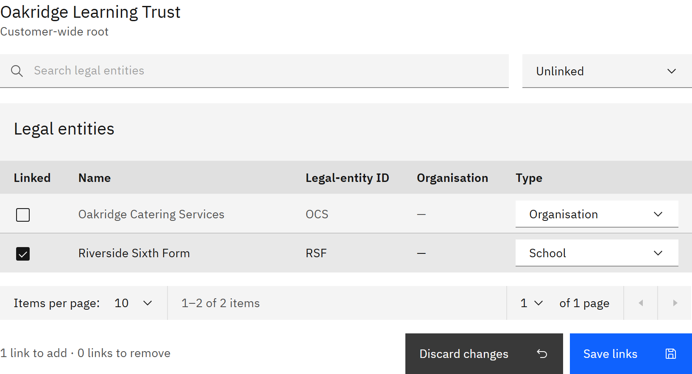

# Link legal entities to an organisation

Legal entities are the companies and schools in your HR system. Linking one places it in your organisation structure,
so the people HR places in that legal entity are put in the right unit at each HR sync.

You need the **Organisation administrator** role. Your organisation must use the HR integration, and the legal entities
must have been imported. See [Import legal entities](../14-HR-integration/06-import-legal-entities.md).

1. Select the parent

   Go to **Manage** → **Organisation structure** and select the organisation the legal entities should sit under.

2. Find the legal entities

   In the **Legal entities** table, use **Search legal entities**, or filter by **Linked here** or **Unlinked**.

3. Tick and type

   Tick **Linked** for each legal entity you want here, and choose its **Type**, for example **School**. You can link up
   to 20 at a time.

   

4. Save

   Click **Save links**. Each linked legal entity becomes a unit under the selected organisation, named after the legal
   entity. You can rename it later. If a legal entity is already linked somewhere else, **Move legal-entity links?** asks
   you to confirm the move. Users, memberships and learning history stay as they are.

   To stop linking a legal entity, untick it and click **Save links**. The unit, its people, their access and their
   learning history stay. **Discard changes** throws away links you haven't saved.
