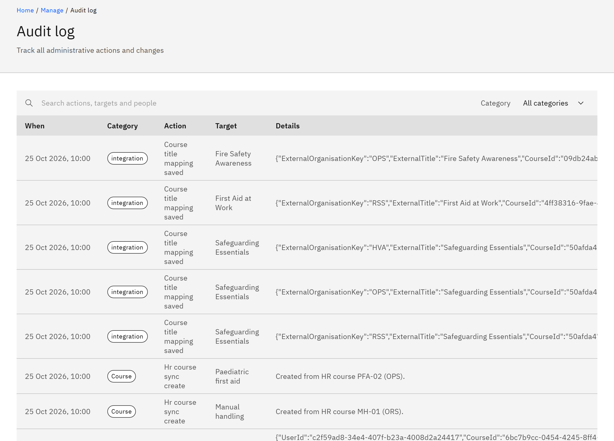

# View the audit log

The audit log records administrative actions and changes: who did what, to what, and when. Automatic actions, such as
an HR sync disabling someone, are recorded too.

You need the **Organisation administrator** role.

1. Open the audit log

   Go to **Manage** → **Audit log**. Entries are listed newest first, with **When**, **Category**, **Action**,
   **Target**, **Details** and **By**.

   

2. Find an entry

   Type in **Search actions, targets and people**, or choose a **Category**: **Course**, **Assignment**, **Channel**,
   **Pathway**, **Role**, **Certificate**, **User** or **System**. The **Details** column says what changed. For example,
   the reason you give when you disable an account appears there.

   The audit log shows the latest 500 entries and can't be edited.
