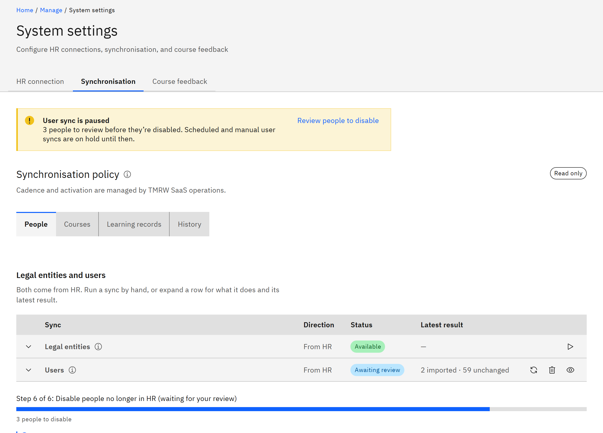

# How the HR integration works

The HR integration keeps GrowthXP and your HR system in step, so nobody has to type staff, schools or
course records in twice. The first HR system supported is **Microsoft Dynamics 365 Finance and Operations** (F&O).

The integration is set up and run by your **Organisation administrator**, with TMRW support switching on each part for
your organisation.

1. Know what comes from HR

   | What | What the platform does with it |
   |---|---|
   | **Legal entities** | Copies your companies and schools, so you can place them in your organisation structure |
   | **People and positions** | Creates an account for each active worker in an occupied position, and keeps their name, work email, job title, department and school up to date |
   | **Employments** | Places each person in the legal entities they're currently employed by, and moves them when HR moves them |
   | **Line managers** | Sets who reports to whom, which gives line managers their team automatically |
   | **Staff categories** | Records each person's category, such as Teacher or Support staff, and adds new categories automatically |
   | **Courses** | Brings courses created in HR in as unpublished drafts, ready for content |
   | **Course participants** | Assigns the course to people registered on it in HR |
   | **Completions recorded in HR** | Marks courses people completed outside the platform as completed, tagged **Recorded in HR** |

2. Know what goes back to HR

   | What | What HR receives |
   |---|---|
   | **Courses** | Courses created in the platform, with their title, description and offering dates |
   | **Course participants** | Assignments made in the platform, once your HR team has approved writes to the participant record |
   | **Learner status** | Each learner's status (not started, in progress or completed), whether the learning is mandatory or recommended, the assigned and due dates, and a link to the course, feedback form or certificate |

3. Know who owns what

   HR is the source of truth for people's HR details and their placement. Anything the platform owns stays in the
   platform: memberships an administrator adds, roles, learning, progress and certificates. HR sync never deletes
   anyone. People who leave HR are disabled and keep their learning records, and they're re-enabled automatically if they
   come back. See [Who the user sync imports](./08-who-the-user-sync-imports.md).

4. Know the safeguards

   - If a user sync would disable more than a set share of your people, it stops before disabling anyone and waits for
     an administrator. See [Review people before they're disabled](./09-review-people-before-they-are-disabled.md).
   - When a course changed on both sides, the platform keeps its own version and lists the difference for you to review.
   - The platform reads only the data it needs, signs in to F&O with a certificate rather than a password, and keeps the
     private key with TMRW.
   - Every sync is recorded in **Sync history**, and the details of each user sync are kept for 7 days or for the latest
     7 runs.

5. Know when it runs

   TMRW support sets how often each sync runs: hourly, every 6 hours, daily or weekly, at a time that suits you.
   Administrators can also run any available sync by hand. See [When HR syncs run](./17-when-hr-syncs-run.md).

6. Get started

   - Check [What you need to connect Dynamics 365](./02-what-you-need-to-connect-dynamics-365.md).
   - [Connect to Dynamics 365](./03-connect-to-dynamics-365.md).
   - Ask TMRW support to switch on the syncs you want. See [Switch on each HR sync](./05-switch-on-each-hr-sync.md).
   - [Import legal entities](./06-import-legal-entities.md) and
     [link them to your organisation structure](../13-Organisation-settings/11-link-legal-entities-to-an-organisation.md).
   - [Run a user sync](./07-run-a-user-sync.md).

   
