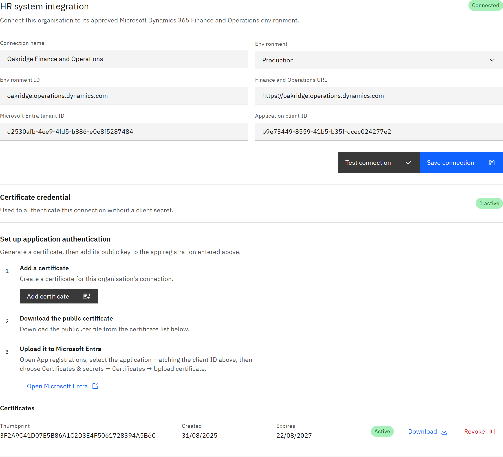
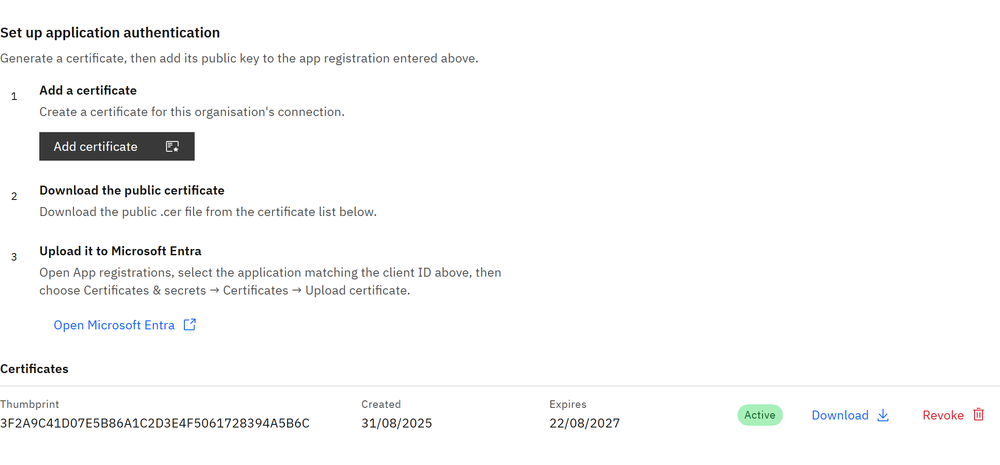

# Connect to Dynamics 365

Connect GrowthXP to your Dynamics 365 Finance and Operations environment. Have the details from
[What you need to connect Dynamics 365](./02-what-you-need-to-connect-dynamics-365.md) ready.

You need the **Organisation administrator** role.

1. Open the HR connection

   Go to **Manage** → **Settings**. The **HR connection** tab opens first, with **Dynamics F&O** chosen under **HR
   integration**. If it says **No HR integrations available**, contact TMRW support.

2. Enter the connection details

   Fill in **Connection name**, **Environment** (**Development**, **UAT** or **Production**), **Environment ID**,
   **Finance and Operations URL**, **Microsoft Entra tenant ID** and **Application client ID**. Click **Save
   connection**.

   

3. Add a certificate

   Under **Set up application authentication**, click **Add certificate**. The new certificate appears in the
   **Certificates** list as **Active**. Click **Download** on it to save the public `.cer` file.

4. Upload it to Microsoft Entra

   Click **Open Microsoft Entra**, open the app registration that matches your **Application client ID**, then choose
   **Certificates & secrets** → **Certificates** → **Upload certificate** and upload the file. You may need your Entra
   administrator for this step.

   

5. Test the connection

   Click **Test connection**. The **Connection test** lists **Microsoft Entra authentication** and each F&O data check,
   such as **Legal entities**, **Staff positions**, **Course catalogue** and **Course participants**. Each should say
   **Passed**, and the connection tag changes to **Connected**. A **Failed** row shows the reason. Usually the
   certificate isn't uploaded yet, or the service user can't read that data entity in F&O.

6. Ask for your syncs to be switched on

   A connected environment doesn't sync anything until TMRW support switches on the syncs you want. See
   [Switch on each HR sync](./05-switch-on-each-hr-sync.md).

   If you later change the environment, tenant, client ID or certificate, syncing stops until the connection passes a new
   test.
