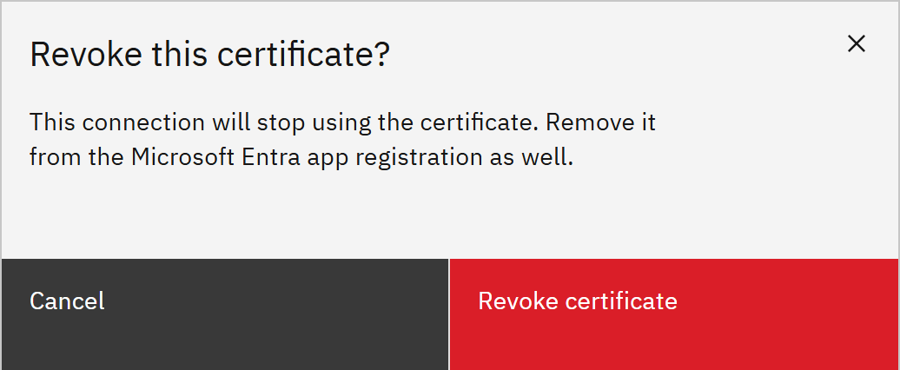

# Replace the connection certificate

Replace the certificate the platform uses to sign in to F&O before it expires, or if you need to stop using it. Add the
new one before you revoke the old one, so syncs keep working.

You need the **Organisation administrator** role.

1. Check the expiry date

   Go to **Manage** → **Settings** → **HR connection**. The **Certificates** list shows each certificate's
   **Thumbprint**, **Created** and **Expires** dates.

2. Add and upload a new certificate

   Click **Add certificate**, then **Download** on the new certificate. Upload the `.cer` file to the app registration in
   Microsoft Entra (**Certificates & secrets** → **Certificates** → **Upload certificate**). You can have up to 5 active
   certificates.

3. Test

   Click **Test connection** and check every row says **Passed**.

4. Revoke the old certificate

   Click **Revoke** on the old certificate, then **Revoke certificate** to confirm. Then remove it from the app
   registration in Microsoft Entra as well.

   

   > **Note:** Revoking can't be undone. If you revoke the only certificate uploaded to Entra, syncs stop until you add
   > and upload a new one.
