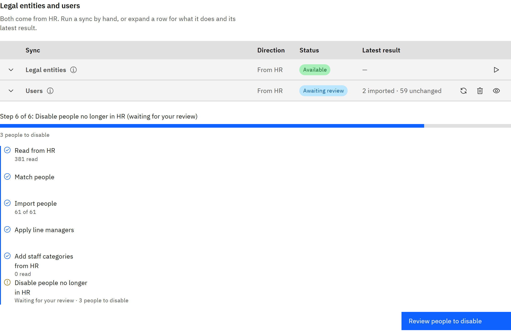

# Switch on each HR sync

Each part of the HR integration is switched on separately, so you can start with people and add courses and learning
records later. Most switches are set by TMRW support, and one is yours.

You need the **Organisation administrator** role.

1. Decide what you want

   | Sync | Direction | Who switches it on |
   |---|---|---|
   | **Legal entities** | From HR | TMRW support |
   | **Users** | From HR | TMRW support |
   | Line managers from HR | From HR, with Users | TMRW support |
   | Employment details and staff categories | From HR, with Users | TMRW support |
   | **Courses** | To HR | TMRW support, with the F&O company and course type to use |
   | **Courses** | From HR | TMRW support |
   | **Course participants** | Both ways | TMRW support. Writes to HR also need your F&O team to approve them |
   | **Completions from HR** | From HR | TMRW support |
   | **Learner status to HR** | To HR | TMRW support makes it available, then you turn on **Send learner status** |

   Disabling people who are no longer in HR, and adding staff categories from HR, are on by default once Users is
   switched on.

2. Ask TMRW support

   Contact TMRW support with the syncs you want, the F&O legal entities to read courses and participants from, and the
   schedule you'd like. See [When HR syncs run](./17-when-hr-syncs-run.md).

3. Check what's available

   Go to **Manage** → **Settings** → **Synchronisation**. Each sync's **Status** shows whether you can run it, for
   example **Available**, **Not activated** or **Unavailable**. Expand a row to see why a sync isn't available.

   

4. Turn on learner status

   When learner status is available, see [Send learner status to HR](./14-send-learner-status-to-hr.md).
