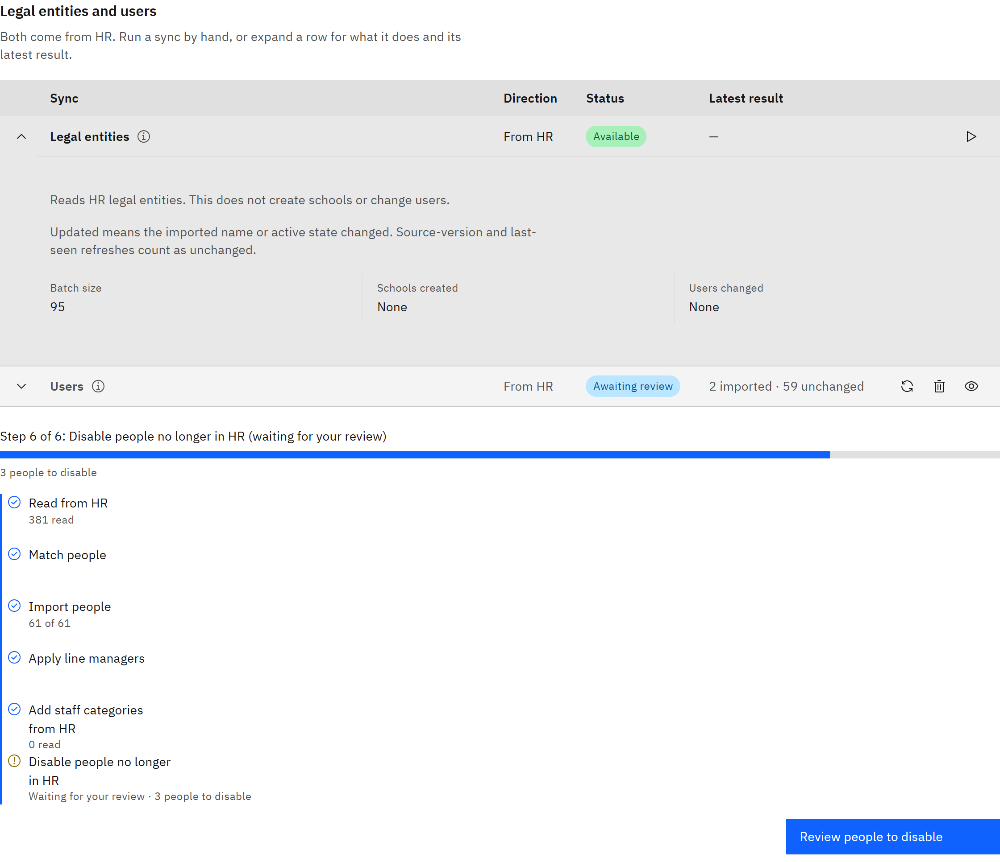

# Import legal entities

Copy your companies and schools from HR, so you can place them in your organisation structure. Importing doesn't create
schools or change anyone's account. It only makes the legal entities available to link.

You need the **Organisation administrator** role.

1. Open the People sub-tab

   Go to **Manage** → **Settings** → **Synchronisation** and open **People**.

2. Run the import

   On the **Legal entities** row, click **Sync now: legal entities**. To stop it part-way, click **Pause import**; click
   **Resume import** to carry on from where it stopped.

   

3. Check the result

   The **Latest result** shows how many legal entities were found, new, updated and unchanged. **Updated** means a legal
   entity's name or active state changed in HR.

4. Link them to your structure

   Go to **Manage** → **Organisation structure** and link each legal entity to the right place. See
   [Link legal entities to an organisation](../13-Organisation-settings/11-link-legal-entities-to-an-organisation.md).
   Do this before your first user sync, so people are placed in the right schools.

   After the first import, legal entities are refreshed automatically if TMRW support has scheduled it.
