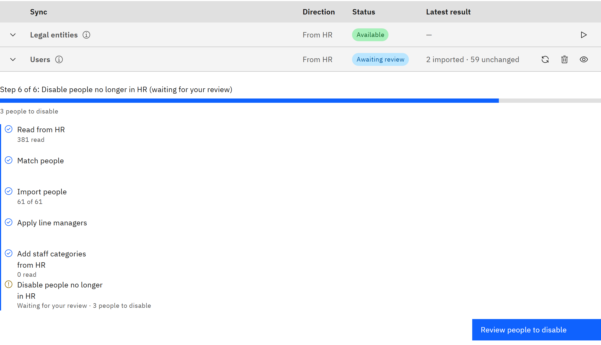
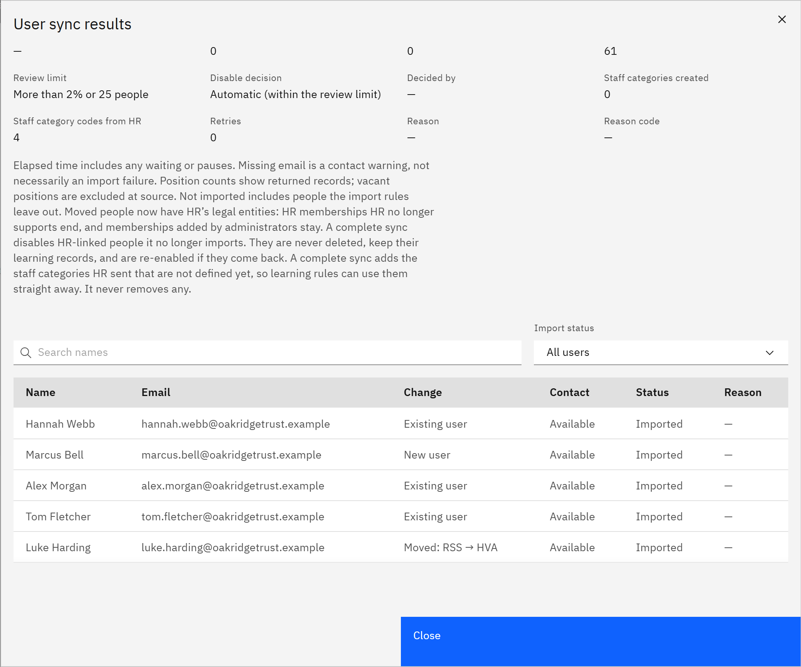

# Run a user sync

A user sync brings your staff in from HR. It creates accounts for new people and updates details and placements for
everyone else. User syncs also run on your schedule; run one by hand when you don't want to wait.

You need the **Organisation administrator** role.

1. Start the sync

   Go to **Manage** → **Settings** → **Synchronisation** and open **People**. On the **Users** row, click **Sync now:
   users**. If the button isn't available, check the row's **Status**: **Not activated** means TMRW support hasn't
   switched user sync on yet.

2. Follow its progress

   Under the table, a progress bar shows the current step, such as **Step 1 of 6: Read from HR**, with a list of every
   step the run takes:

   | Step | What happens |
   |---|---|
   | **Read from HR** | Reads workers, positions, worker statuses, employments and, if used, staff categories and line managers, all at the same time. Each table's count is listed while it's read |
   | **Match people** | Matches each worker to an account, and applies the import rules |
   | **Import people** | Creates and updates accounts and placements, for example "7,000 of 28,000" |
   | **Apply line managers** | Sets who reports to whom, if line managers come from HR |
   | **Add staff categories from HR** | Adds categories HR sent that aren't defined yet |
   | **Disable people no longer in HR** | Disables people the sync no longer imports |

   A run only lists the steps it uses. You can leave the page; the sync carries on.

   

3. Pause, resume or cancel if you need to

   For a run you started, click **Pause sync** to stop after the current step and **Resume sync** to carry on. Scheduled
   runs can't be paused. To stop any run for good, click **Cancel sync**, then **Cancel sync** again to confirm. People
   already imported stay, and you can start a new sync straight away. A cancelled run can't be resumed.

4. Check the results

   When the run is **Completed**, the **Latest result** shows how many were imported, unchanged and disabled. Click
   **View results** for the full list: search by name, or filter by **Import status**, such as **Not imported**,
   **Moved**, **Re-enabled** or **Disabled or to be disabled**. The **Reason** column says why someone wasn't imported.

   

   People with no work email in HR are still imported, marked **Pending: missing email**. If the run stops at **Awaiting
   review**, it would disable more people than your review limit. See
   [Review people before they're disabled](./09-review-people-before-they-are-disabled.md).
