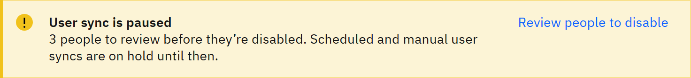
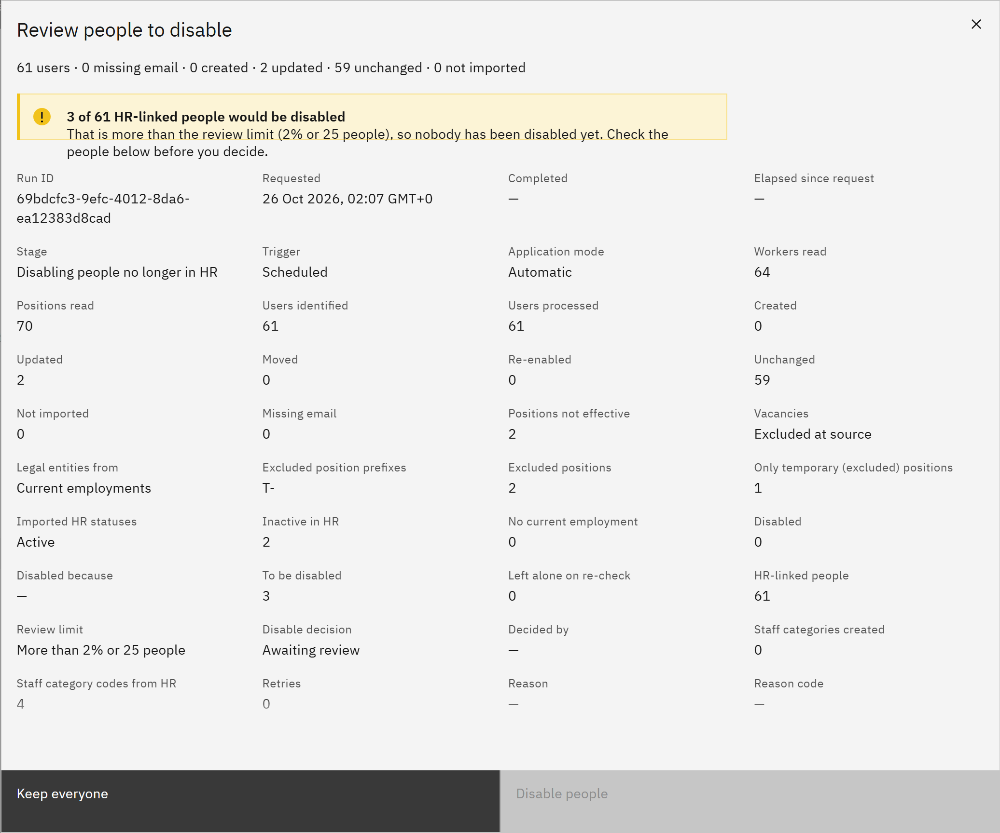

# Review people before they're disabled

If a user sync would disable an unusually large number of people, it stops before disabling anyone and waits for an
administrator to check. This protects you from a wrong filter or an incomplete read in HR.

You need the **Organisation administrator** role. A sync you started by hand can only be reviewed by you. A scheduled
sync can be reviewed by any organisation administrator.

1. Know when a sync is held

   A sync is held when it would disable more than **5%** of the people linked to HR, or more than **200** people,
   whichever is reached first. TMRW support can change these limits for your organisation. While it's held, nobody has
   been disabled.

2. Notice the banner

   **User sync is paused** appears on the **Manage** overview and on **Settings** → **Synchronisation**. It says how
   many people are waiting to be reviewed, and that scheduled and manual user syncs are on hold until then. No other user
   sync starts, scheduled or manual, until the held sync is decided. If you can't review it, the banner says who can.

   

3. Open the review

   Click **Review people to disable**. The dialog says how many of your HR-linked people would be disabled, and lists them
   with the **Reason**, such as **No longer in HR**, **Inactive in HR** or **No current employment in HR**.

   

4. Check the list

   Search the list and look for anything unexpected, such as a whole school, or people you know are still working. If
   it looks wrong, choose **Keep everyone** and ask your HR team to check the data before the next sync.

5. Decide

   To go ahead, tick **I have checked the people listed and approve disabling their accounts** and click **Disable
   people**. To complete the sync without disabling anyone, click **Keep everyone**.

   > **Note:** Disabled people can't sign in until a later sync finds them in HR again or an administrator re-enables
   > them. Their learning records are kept.

   Either way, the sync completes and user syncs carry on as normal. **Sync history** records the decision and who made
   it.
