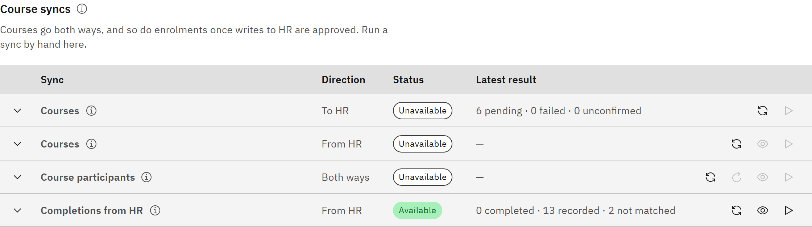

# Sync courses with HR

Courses can go both ways. Courses created in the platform are sent to HR, so HR knows they exist. Courses created in HR
come into the platform as unpublished drafts, ready for content.

You need the **Organisation administrator** role.

1. Open Course syncs

   Go to **Manage** → **Settings** → **Synchronisation** and open **Courses**. The **Course syncs** table has a row for
   each direction.

   

2. Send courses to HR

   Course changes are sent to HR automatically when you save a course. To send outstanding changes sooner, click **Sync
   now: courses to HR**. Courses without the start and end dates HR needs are skipped, not failed. Add **Offering dates**
   to the course and it's sent at the next sync. Failed writes are retried once a day; the row's details show the time
   in your own time zone.

3. Bring courses in from HR

   Click **Preview sync: courses from HR** to see what a sync would do without changing anything. Click **Sync now:
   courses from HR** to run it. A course created in HR becomes an unpublished draft marked **From HR**, with no content.
   Add the course content and publish it as usual. Courses delivered in person are also imported as drafts, because
   in-person sessions aren't supported yet.

4. Review conflicts

   If a course's title, description or self-enrolment setting changed in both places since the last sync, the platform
   keeps its own value and lists it under **Course conflicts**. Check each one, change the course if HR's value is
   right, then click **Mark reviewed**. If only HR changed, HR's value is taken.

5. Check linked courses

   **Linked courses** lists every course that exists in both places, where it was created, and its status on each side.
   A course cancelled or missing in HR is marked, but the platform course is never deleted.
