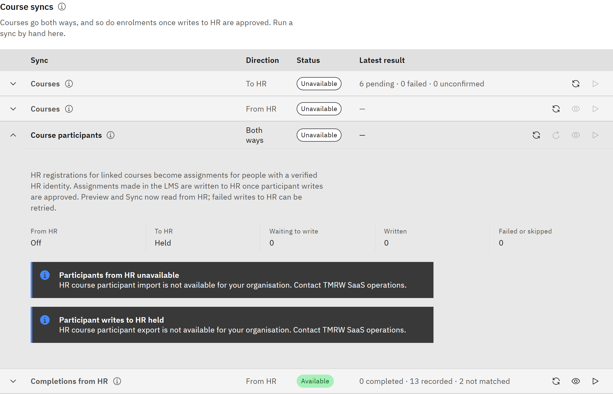

# Sync course participants

Keep course enrolments in step. People registered on a course in HR are assigned it in the platform. Assignments made
in the platform are written back to HR as participants, once writes are approved.

You need the **Organisation administrator** role.

1. Open the Course participants row

   Go to **Manage** → **Settings** → **Synchronisation** → **Courses** and expand **Course participants**. It shows
   whether **From HR** and **To HR** are on or held, and how many writes are waiting, written, and failed or skipped.

   

2. Bring registrations in from HR

   Click **Preview sync: course participants** to see what would happen, or **Sync now: course participants** to run it.
   For courses linked to HR, each registration becomes an assignment for the matching person. By default it's
   recommended, or mandatory when HR marks it required, and the due date comes from HR. No assignment email is sent for
   registrations from HR. A course that's still a draft is assigned once it's published.

3. Know what happens when HR cancels

   When a registration is cancelled in HR, the assignment is withdrawn only if it came from HR and isn't completed.
   Learning assigned in the platform, or required by a learning rule, stays.

4. Write enrolments to HR

   When TMRW support and your F&O team have approved writes, **To HR** shows **On**, and assignments made in the
   platform, including self-enrolments, are written to HR. Until then they're held, not lost. Click **Retry failed
   writes** to send failed or skipped writes again.
