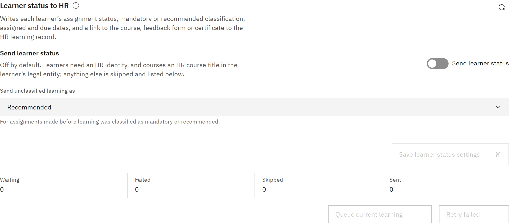

# Send learner status to HR

Keep each person's HR learning record up to date with their progress, so HR and employee self-service see the same
status as the platform.

You need the **Organisation administrator** role.

1. Know what's sent

   For each person and course, the platform writes the status (not started, in progress or completed), whether it's
   mandatory or recommended, the assigned and due dates, and a link. The link goes to the course, then to the feedback
   form while required feedback is outstanding, then to the certificate. An unchanged status isn't sent again, and
   withdrawn learning leaves the HR record as it is.

2. Turn it on

   Go to **Manage** → **Settings** → **Synchronisation** → **Learning records**. Under **Learner status to HR**, turn on
   **Send learner status**. In **Send unclassified learning as**, choose **Recommended** or **Mandatory** for older
   assignments made before learning was classified. Click **Save learner status settings**.

   

   If you see **Not sending**, something else needs to happen first, such as TMRW support making the export available.
   Changes are kept and sent once it's resolved.

3. Send existing learning

   To send everyone's current learning, not only new changes, click **Queue current learning**.

4. Check updates

   **Updates sent to HR** lists each update as **Waiting**, **Failed**, **Skipped** or **Sent**, with the reason. Failed
   updates are retried automatically a few times. Click **Retry** on a row, or **Retry failed** for all of them, to send
   them again.

   A learner needs an HR identity, and the course needs an HR course title in the learner's legal entity. Otherwise the
   update is skipped. See [Map HR course titles](./15-map-hr-course-titles.md). Completions that came from HR are never
   written back, and a record HR already has as completed is never lowered.
