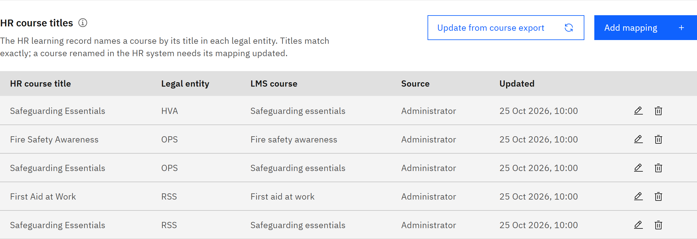

# Map HR course titles

Your HR learning record names courses by title, separately in each legal entity. Mappings tell the platform which HR
title belongs to which course. Learner status and completions from HR both use them.

You need the **Organisation administrator** role.

1. Open HR course titles

   Go to **Manage** → **Settings** → **Synchronisation** → **Learning records** and find **HR course titles**. The table
   lists each **HR course title**, its **Legal entity**, the **LMS course**, its **Source** and when it was **Updated**.
   **Needs attention** lists anything missing or ambiguous.

   

2. Fill in mappings automatically

   Click **Update from course export**. Courses already sent to HR are mapped by the title HR holds for them. This also
   happens automatically every hour.

3. Add a mapping by hand

   Click **Add mapping**. Enter the **Legal entity** code, the **HR course title** exactly as it appears in HR, and choose
   the **LMS course**. Click **Save mapping**.

4. Change or remove a mapping

   Click **Change course** or **Remove mapping** on the row. Titles must match exactly, including capitalisation. If a
   course is renamed in HR, update its mapping.
