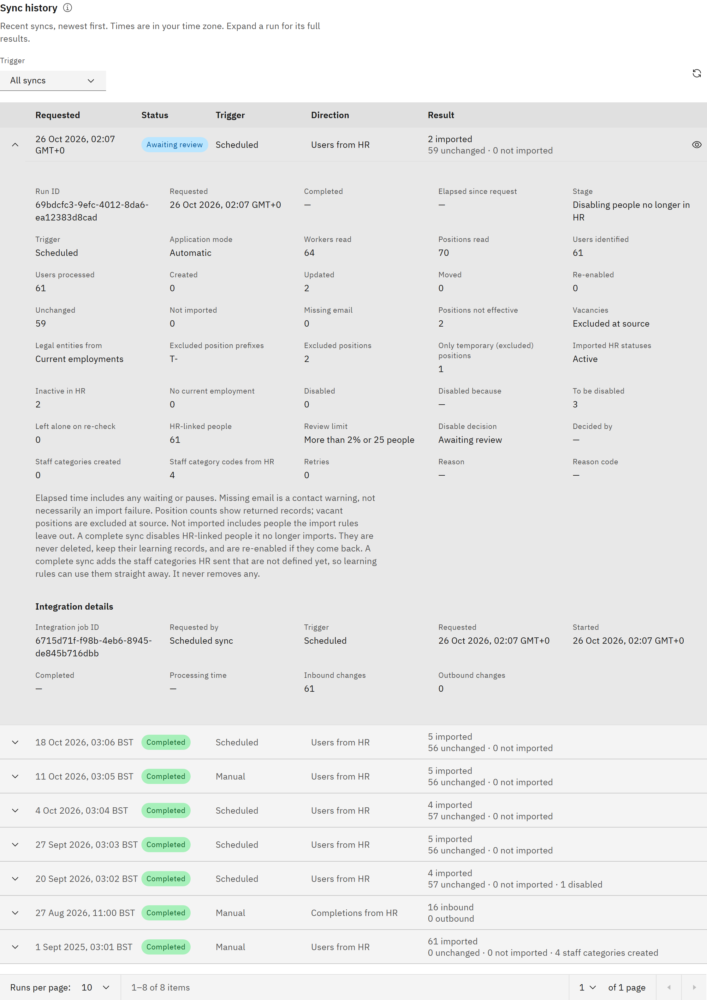

# Check sync history

See every HR sync, scheduled or manual, newest first: when it ran, whether it worked, and what it changed.

You need the **Organisation administrator** role.

1. Open History

   Go to **Manage** → **Settings** → **Synchronisation** and open **History**. **Sync history** lists recent syncs with
   **Requested**, **Status**, **Trigger**, **Direction** (for example **Users from HR** or **Courses to HR**) and
   **Result**. Times are in your own time zone, with its short name.

   

2. Filter

   Choose a **Trigger**: **All syncs**, **Manual** (including individual imports), **Scheduled**, **Course changes** or
   **Not recorded**. Click **Reload sync history** to refresh.

3. Look at a run

   Expand a row for its details. A user sync shows its **Stage**, **Trigger**, the counts (**Created**, **Updated**,
   **Moved**, **Re-enabled**, **Unchanged**, **Not imported**, **Disabled**), the import rules it applied, and the
   **Disable decision** with who made it. **Elapsed since request** is how long the run took from start to finish,
   including any pauses or time waiting for review. Other syncs show their **Processing time**. A failed run shows its
   **Reason**.

4. See the people in a user sync

   Click **View run** on a user sync to open its results and search the people it read and changed.

   To save space, these details are kept for 7 days, or for as long as the run is one of your latest 7 user syncs,
   whichever is longer. After that, the run shows **Details removed after 7 days**, and its counts stay in the history.
