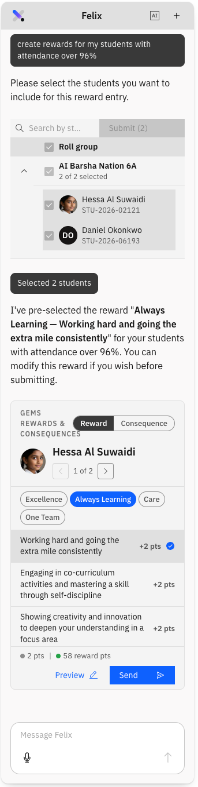

# Log rewards for several students

When a group has earned the same recognition, log it once rather than student by
student. The flow is the same as a single log — see
[Log a reward or consequence](./08-log-a-reward-or-consequence.md) — with a
selection step at the front.

1. Prompt Felix

   Open **Felix** and prompt *create rewards for my students*.

2. Select the students

   Felix lists the students in your class. Select the ones you want, or select all,
   then submit. Long lists are paged — use the arrows to move through them.

   

3. Set the value once

   Choose the **value** and **points**. Your selection is applied to every student
   you picked. For certain rewards, the school may assign the points.

4. Adjust individuals

   Move between students with the arrows and change anyone who needs something
   different — a different value, different points, or switching that one student
   to a **consequence** while the rest stay as rewards. Each student's own running
   tally is shown as you go.

5. Preview and send

   **Preview** shows what each student and their parents will receive. Then click
   **Send**.
