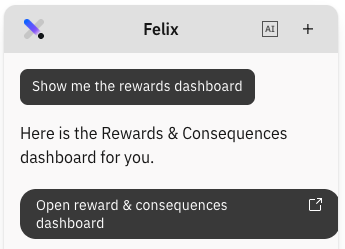

# View the rewards dashboard

The dashboard shows what you have logged this term and where the gaps are — which
students you have recognised, which you have not, and how your rewards balance
against your consequences.

1. Ask for the dashboard

   Open **Felix** and prompt *show me the rewards dashboard*. Felix will send a link to open it.

   > **Note:** Include the word **rewards**. *Dashboard* on its own returns
   > nothing, because StaffXP has several.

   

2. Read your term totals

   The dashboard covers:

   - **Rewards/Consequences logged** — rewards and consequences, split out.
   - **Reward-to-consequence ratio** — how positive your logging has been.
   - **Points issued**.
   - **Students recognised** — how many individuals, not how many logs.
   - **Milestones reached** - if any students have reached milestones this week.

3. Check the trends

   A weekly trend chart shows your logging over the term, and a breakdown shows
   rewards and consequences across your classes and by value. The picture becomes
   more useful the more regularly you log.

4. Act on the insight

   The dashboard flags **students not recognised for three or more weeks**. You can
   ask Felix to suggest a reward for them.

5. Log from the dashboard

   Buttons at the top of the dashboard start a **reward**, a **consequence** or a
   **bulk entry** without going back to the chat panel.

## The leader view

School leaders and admins get a wider version of the same dashboard, covering
every class and teacher in their school rather than just their own logging. What a
teacher sees is limited to their own classes.
