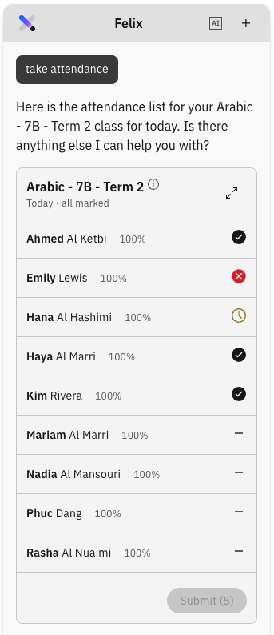

# Take attendance with Felix

You can take the roll without leaving what you are doing. Ask Felix and it brings
the class roll into the chat panel, where you mark students and submit just as you
would on the **Attendance** page.

To take the roll from the Attendance page instead, see
[Take the daily roll](../03-Attendance/02-take-attendance-roll.md).

1. Ask Felix for the roll

   Open **Felix** and prompt *show me attendance*, or _take attendance_. Felix looks up your timetable
   and shows the roll for your class in the chat panel.

   > **Note:** Check the class name and time before you start marking. Felix
   > picks the class from your timetable, so make sure it is the one you meant.
   > Felix takes attendance for today's classes only — ask for a future class and
   > it tells you so.

2. Mark each student

   For each student, choose **Present**, **Absent** or **Late**.

   

3. Expand to the canvas, if you want more room

   Expand the roll to open it in the canvas beside the chat. You can do this by clicking the diagonal arrows in the top right. The canvas shows the
   full roll in more detail, and you can carry on marking there.

4. Submit the roll

   When every student has a status, the **Submit** button is enabled — click it. Submit stays
   disabled while any student is unmarked, so a partial roll cannot be sent.

5. Check the result

   The submitted marks show on the roll in the canvas straight away.

   > **Note:** Once submitted, the roll is locked. To change a mark, ask Felix
   > for a correction — see
   > [Request an attendance correction with Felix](./15-request-an-attendance-correction-with-felix.md).
