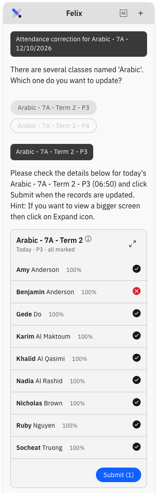
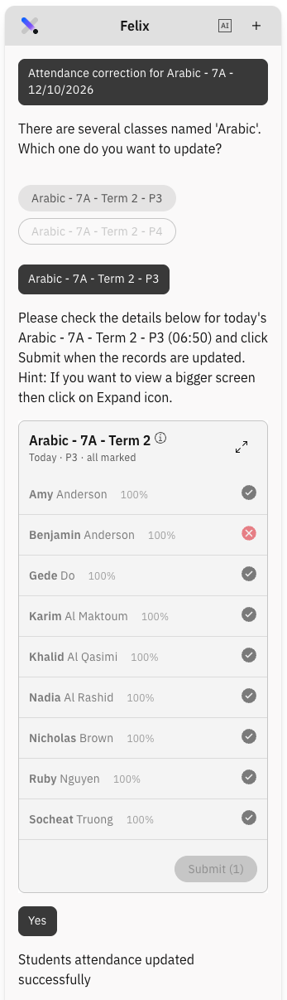

# Request an attendance correction with Felix

{/* SOURCE — 9 Oct 2026 SXP Felix Attendance walkthrough with Amber Do (11:24–19:15).
Demonstrated in the DEV environment, not UAT (Amber, 25:03).
TO RE-VERIFY BEFORE PUBLISHING:
(1) The flow differs from the build documented in
    ../03-Attendance/08-request-attendance-correction.md, where Felix opens a form
    pre-filled for a recent session and asks for a reason. In this demo Felix
    replied with a button to open the form, and the teacher picked the date and
    then the class. A reason field was not shown or mentioned. Confirm which flow
    is in UAT, then align this page and page 08.
(2) The officer side was not shown end to end. The data had not synced after
    submission (19:15), so approve or deny is written from Amber's description.
(3) The wording of the alert for a class with no students was not read out.
No screenshots — the transcript holds speaker avatars only. Add to ./images/ from a
UAT build. */}

Once you submit a roll it is locked. To change a mark — a student you marked
present who actually arrived late, say — you ask Felix for a correction, and an
attendance officer reviews it.

> **Note:** Felix is the only way to raise a correction. The canvas and the roll
> itself do not offer one.

1. Ask Felix for a correction

   Open **Felix** and say that you need an **attendance correction** for a **past**
   mark, with the date — for example *I need an attendance correction for 28
   September*. Felix needs both to recognise what you are asking for, so be
   specific. You can give the full details up front (student, class and date), or
   start with a general prompt and fill in the form.

   

2. Open the correction form

   Felix replies with a button to open the **correction form**. Click it.

3. Pick the date and class

   Select the **date**. The class list filters to the classes that ran that day —
   pick the one you need. If that class has no students, an alert will tell you.

4. Choose the student and the corrected mark

   Select the student whose mark is wrong and set the mark it should have been —
   for example from **Present** to **Late**.

5. Submit the request

   Submit the form. Felix confirms the request has been submitted and sends it to
   an attendance officer.

  

6. Leave it with the attendance officer

   The request appears on the officer's **Correction request** tab, where they
   approve or deny it. It can take a few minutes to appear while the data syncs.
   For the officer's side, see
   [Resolve and correct attendance marks](../03-Attendance/12-resolve-attendance-marks.md).
