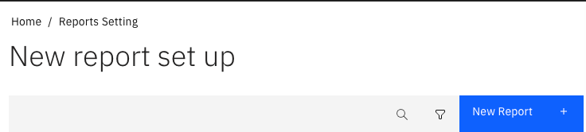
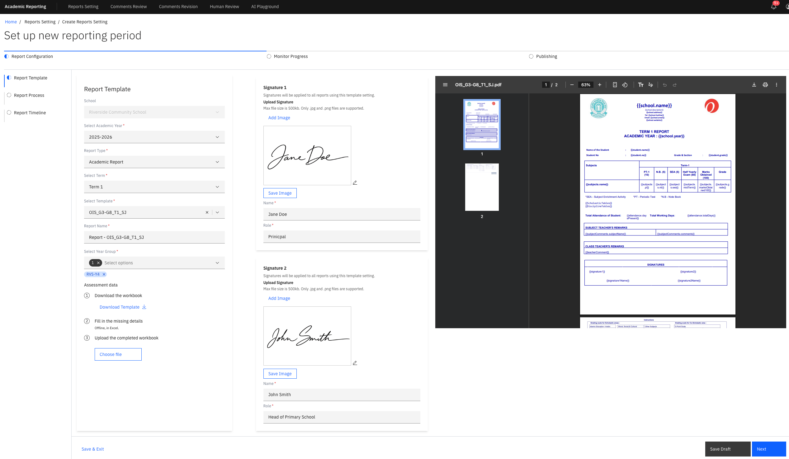

# Create a new report

{/* SOURCE — Academic Reporting Tool walkthrough video transcript
(AR_Video Transcript.docx, received 13 Oct 2026).
TO VERIFY: the exact name of the landing page (transcript: "report setting page")
and of the New report button; the fields in a signature block.
No screenshots available — add to ./images/ from a UAT build. */}

Setting up a report takes three steps: **report template**, **report process**
and **report timeline**. This page covers the first. You need admin access to
the academic reporting tool.

1. Start a new report

   As an admin, you have access to the **Report Setting** page. Click
   **New Report +** to start a new report cycle.

   

2. Choose the school

   **School** is filled in with your school by default. Change it only if you set
   up reports for more than one school.

3. Enter the report details

   Select the **Academic year**, **Term** and **Template**, enter a **Report
   Name**, and select the **Year Group** the report is for.

   

4. Preview the template

   You can preview how the finished report will be laid out with the
   template you selected.

5. Add assessment data, if the template needs it

   If the template includes information that has to be entered manually, the
   **Assessment data** section asks for a completed workbook — see
   [Upload assessment data](./03-upload-assessment-data.md).

6. Add signatures, if the report needs them

   Upload the signature images and fill in the details in each signature block.

7. Move on to the report process

   Once everything required is configured, go to the next step — see
   [Configure the report process](./04-configure-the-report-process.md).
