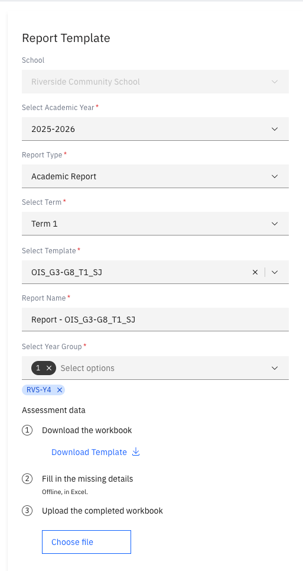
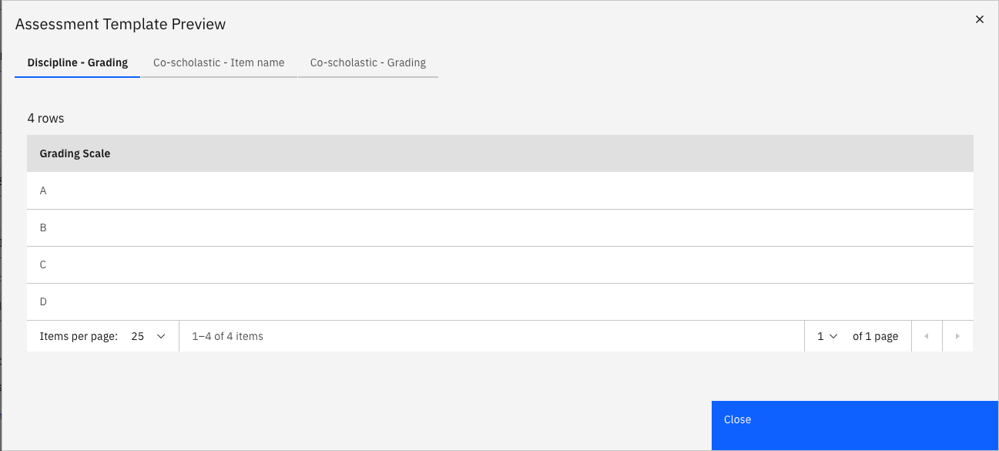

# Upload assessment data

{/* SOURCE — Academic Reporting Tool walkthrough video transcript
(AR_Video Transcript.docx, received 13 Oct 2026).
TO VERIFY: what happens if the uploaded workbook fails validation — the transcript
only shows a successful upload.
No screenshots available — add to ./images/ from a UAT build. */}

Some report templates include information that isn't held anywhere in the
system and has to be supplied by hand. You provide it as a workbook, uploaded in
the **Assessment data** section of the **Report template** step — see
[Create a new report](./02-create-a-new-report.md).

1. Download the workbook template

   In **Assessment data**, click **Download**. The workbook is built for the
   template you selected, so it asks only for what this report needs.

   

2. Fill in the workbook

   Open the workbook. The required information is organised across several
   sheets; read the instructions in each and enter the data for every item.

3. Upload the completed workbook

   Back in the report setup, click **Choose file** and select the completed
   workbook.

4. Check the uploaded data

   Once the file uploads, preview the information it contains and check that it came
   through correctly. Click **Close** to return to the setup page.

   
