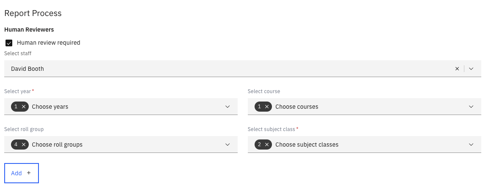
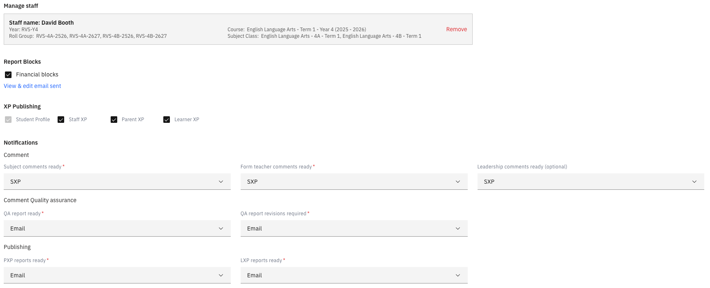

# Configure the report process

The second setup step controls how the report moves through the reporting cycle:
who reviews it, which students' reports can be held back, what parents are sent,
and where the finished report goes.

1. Assign human reviewers, if you want them

   Human reviewers are optional. To add one, select the **staff member**, the
   **year group** and the **roll group**, and, if needed, the **course** and then
   the **subject class**. Click **Add** to confirm.

   Each subject class or roll group can have only one human reviewer. Once one is
   assigned, you can't assign it to anyone else.

   

2. Configure the report blocks

   Set up the report blocks this report needs. A report block holds back a
   student's report, for example for financial reasons, until it is resolved —
   see [Manage report blocks](./07-manage-report-blocks.md).

3. Review the parent email template

   Click **View & edit email sent** to check the email template that will be sent to parents.

4. Set publishing and notifications

   Configure the publishing and notification settings to decide how the
   finished report is shared with the relevant systems.

   

5. Check it against your process

   Review the whole configuration against your school's reporting workflow, then
   move on to the final step — see
   [Set the report timeline](./05-set-the-report-timeline.md).
