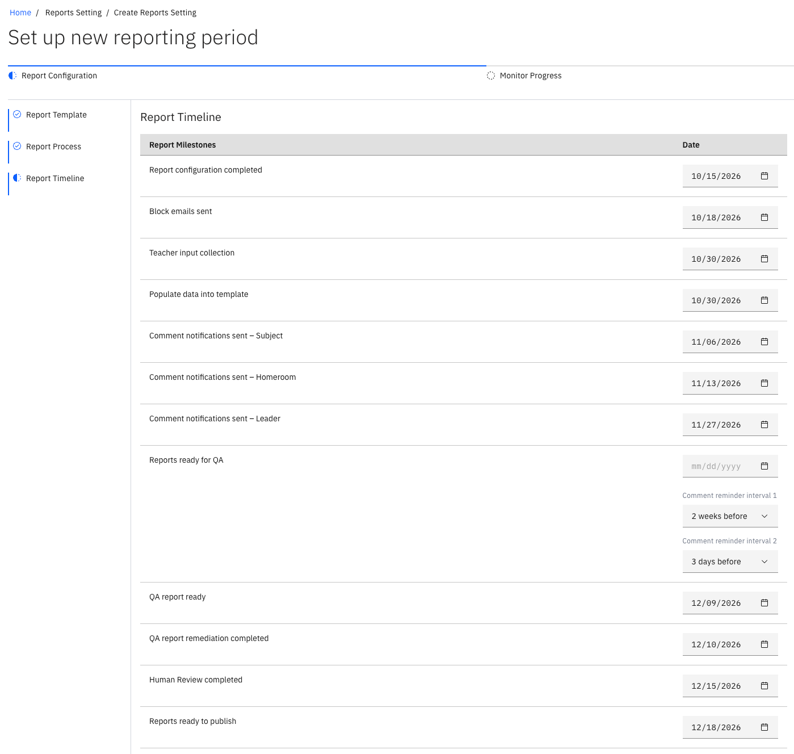

# Set the report timeline

{/* SOURCE — Academic Reporting Tool walkthrough video transcript
(AR_Video Transcript.docx, received 13 Oct 2026).
TO VERIFY: whether the system blocks out-of-sequence dates or only expects you to
avoid them; whether a confirmed report can still be edited; whether milestones
run automatically on their trigger date or only when an admin executes them.
No screenshots available — add to ./images/ from a UAT build. */}

The last setup step puts dates on the reporting cycle. Each **milestone** — such
as input collection, comment review, quality assurance (QA) and publishing — gets a trigger date.
See [How academic reporting works](./01-how-academic-reporting-works.md) for the
full list.

1. Set a trigger date for each milestone

   Work down the milestones and set a trigger date for each.

   

2. Check the sequence

   Make sure the milestones follow the required order. Some can overlap,
   depending on your workflow. The system will notify you if any dates are too early. For example, if the dates were set before the report configuration is completed.

3. Confirm the setup

   When every date is set, click **Confirm**. The report appears in the report
   list, ready to run — see
   [Run the report timeline](./06-run-the-report-timeline.md).
