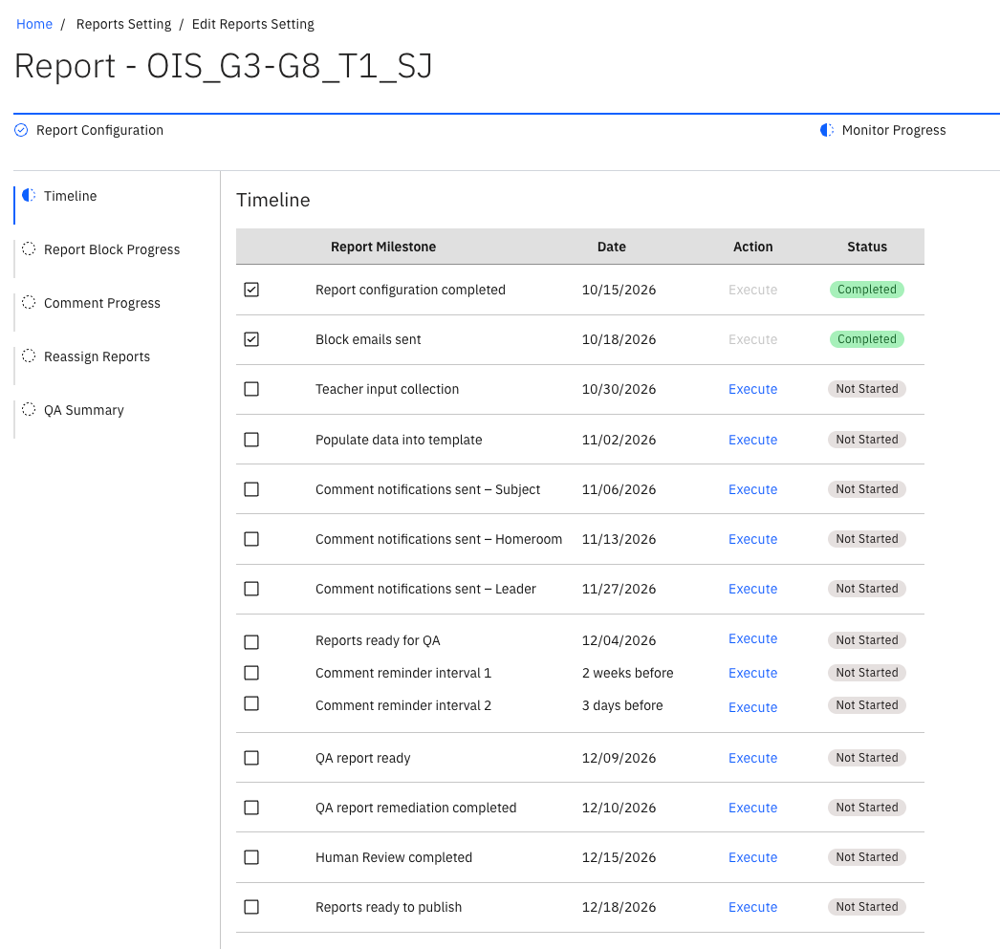

# Run the report timeline

Once a report cycle is set up, you track it in the **Monitor Progress** tab. The **Timeline**
lists every milestone that has to be completed before the report can be
published.

1. Open the report

   In the report list, click the report title to open its details, then go to the
   **Monitor Progress** tab. It lists each part of the cycle — the timeline,
   report blocks, reassignment, comment progress and quality assurance (QA).

2. Read the timeline

   **Timeline** lists the milestones in order. Each has an **Execute** button and
   a status, so you can see at a glance which are complete.

   

3. Execute the next milestone

   Click **Execute** on the next milestone in the sequence. When it finishes, its
   status updates and you get a notification. Click the notification to go
   straight to the page where you pick up the next task.

4. Follow up each milestone

   | Milestone | Then |
   | --- | --- |
   | **Block email sent** | [Manage report blocks](./07-manage-report-blocks.md) |
   | **Input collection** | [Configure input collection](./09-configure-input-collection.md) |
   | **Populate data into template** | [Monitor comment progress](./11-monitor-comment-progress.md) |
   | **Comment notification sent** | Teachers [review and submit class comments](./12-review-and-submit-class-comments.md) |
   | **Report ready for QA**, then **QA report ready** | [Review the QA summary](./13-review-the-qa-summary.md) |
   | **QA remediation completion** | Completes once no comment needs revising; human reviewers start [their review](./15-complete-a-human-review.md) |
   | **Human review completed** | Completes once every human review task is done |
   | **Ready to publish** | [Publish reports](./16-publish-reports.md) |

5. Re-execute a milestone that didn't complete

   If a milestone stays incomplete because a condition isn't met, fix the
   underlying issue and execute it again. **Reports ready to publish**, for example, stays
   incomplete until every blocker is resolved.
