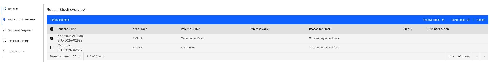

# Manage report blocks

{/* SOURCE — Academic Reporting Tool walkthrough video transcript
(AR_Video Transcript.docx, received 13 Oct 2026).
TO VERIFY: the exact name of the resolve action; whether a resolved block can be
reopened (transcript: "no further action is available for the student"); whether
reasons other than financial ones can raise a block. Transcript calls the page both
"report block sub tab" and "report block progress page".
No screenshots available — add to ./images/ from a UAT build. */}

A **report block** holds back a student's report — for example, where there is
an outstanding financial matter. Blocked reports are followed up with the
student's parents, and every block must be resolved before the report can be
published.

1. Collect the blocked students

   On the report's **Timeline**, execute the **Block emails sent** milestone. It
   gathers every student who has a report block. When it completes, you get a
   notification; click it to open the **Report Block Progress** sub-tab.

2. Send the first email

   The sub-tab lists every student with a report block. Select a student to see
   the actions available, then click **Send** to email the student's parent. The
   status changes to **Email sent**, and a **Send** button appears in the
   **Reminder action** column.

   

3. Send reminders

   Click **Send** in the **Reminder action** column whenever a reminder is needed. Hover
   over the status to see the date of the latest action.

4. Resolve the block

   Once the issue is cleared, select the student and click **Resolve Block** on the top right of the table to clear
   the block. After that, no further action is available for that student. The **Status** will update to **Block resolved**.

   > **Note:** Resolving a block can't be undone from this screen. Resolve it only
   > once the matter is actually cleared.
