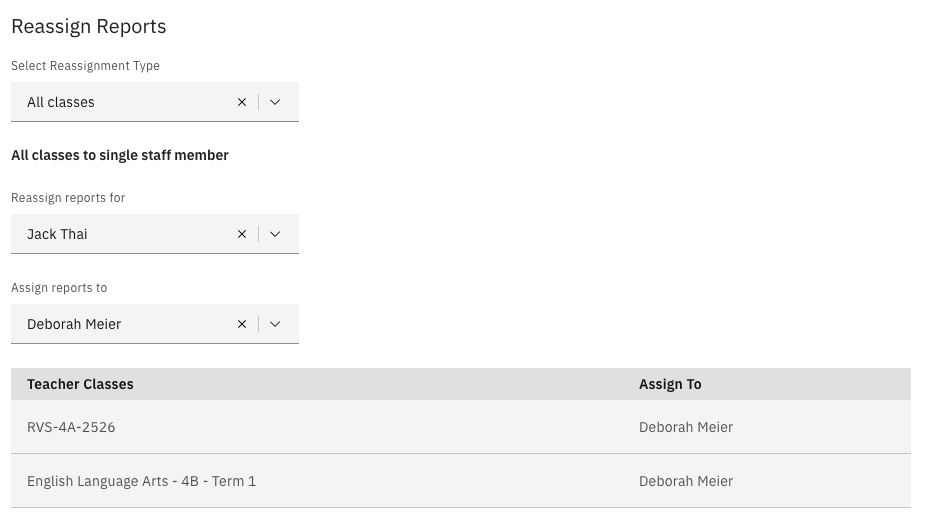
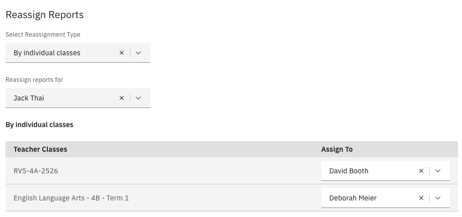

# Reassign report tasks

If a teacher can't complete their reporting tasks, you can move their classes to
another teacher. You can hand over everything in one go, or split their classes
between several teachers.

1. Open the reassignment screen

   On the report's **Monitor Progress** tab, go to the **Reassign Reports** sub-tab.

2. Reassign all of a teacher's classes

   Choose **All classes**. Select the teacher whose tasks need to move, then the
   teacher who will receive them. The table lists every eligible class, with the
   receiving teacher filled in under the **Assign to** column in the table below; it can't be changed here.
   Review the classes and confirm the reassignment.

   

3. Or reassign classes one by one

   Choose **By individual classes** and select the teacher whose tasks need to
   move. The table lists every class assigned to them. Under the **Assign to** column,
   select the receiving teacher for each class you want to move. You can send
   different classes to different teachers. Confirm the reassignment.

   

4. Check the history

   Click **View history** to see every reassignment made for this report.
