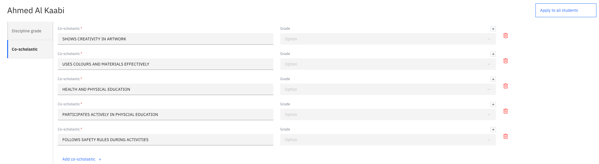

# Configure input collection

**Teacher input collection** is the stage where teachers enter grades for their
students. As the admin, you start it and set up what is collected; you can't
enter grades yourself.

1. Start input collection

   On the report's **Timeline**, execute the **Teacher input collection** milestone.
   Teachers are notified that they can start entering information, and you get a
   notification when the milestone completes.

2. Open a class

   Open a class in the **Comments Review** tab. In the dropdown, **Select Report**. From here, you can open a class to track its comment review progress. Select the **Teacher input collection** tab, and the
   left-hand panel lists the data types that need input.

3. Edit the master data

   Configure or edit the master data items for the class, if needed. For example, a
   **criteria name** or the **grade scale**. Click **Save** to keep your changes.

   

4. Apply to the whole class

   To use the current student's values for every student in the class, click
   **Apply to all students**.

Teachers then enter grades against what you've configured — see
[Enter student grades](./10-enter-student-grades.md).
