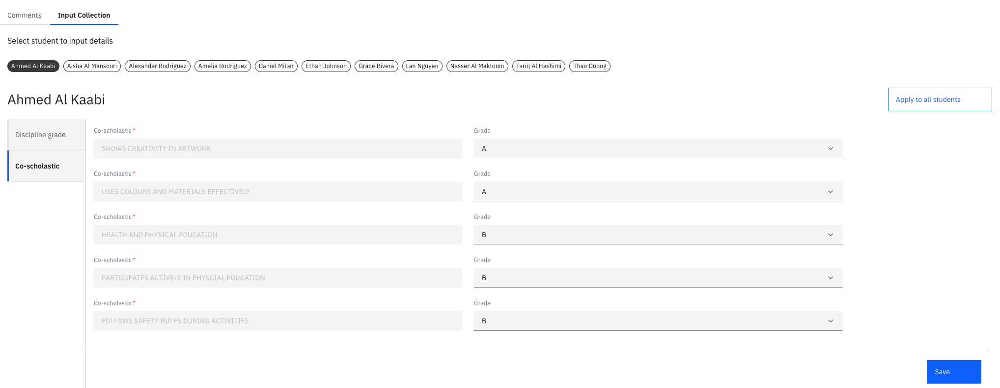

# Enter student grades

{/* SOURCE — Academic Reporting Tool walkthrough video transcript
(AR_Video Transcript.docx, received 13 Oct 2026).
TO VERIFY: whether grade input has its own submit step or is complete once saved;
whether the input notification really lands on the "comment review" page.
No screenshots available — add to ./images/ from a UAT build. */}

When your school's admin opens input collection for a report, you enter the
grades for each class you've been assigned. The grade scale and criteria are set
by the admin — see [Configure input collection](./09-configure-input-collection.md).

1. Open the report from your notification or go to the Comments Review tab

   You get a notification when a class is assigned to you and another asking you
   to start input. Click it to open the **Comments Review** page, which lists the
   classes assigned to you for that report. Optionally, you can access your classes directly from the **Comments Review** tab.

2. Open a class

   Open a class and go to its **Input Collection** tab. You'll see the criteria
   and grade scale the admin has configured.

3. Enter the grades

   Enter each student's grade using the configured grade scale. To give every
   student the same input, click **Apply to all students**.

   

4. Save

   Click **Save** to save the current version. Repeat for each of your classes.
