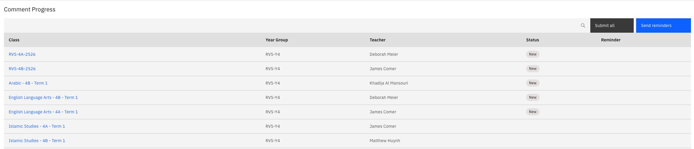
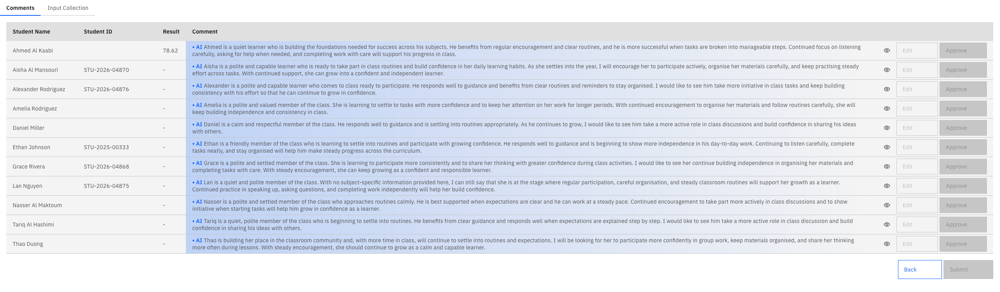

# Monitor comment progress

{/* SOURCE — Academic Reporting Tool walkthrough video transcript
(AR_Video Transcript.docx, received 13 Oct 2026).
TO VERIFY: the status values shown on Comment progress; which role counts as a
"leader" here and how leaders reach the class detail.
No screenshots available — add to ./images/ from a UAT build. */}

Once grades are in, artificial intelligence (AI) drafts a comment for every student. You then follow
teachers' review of those comments from the **Comment Progress** sub-tab, under the **Monitor Progress** tab. Admins
and leaders can read the comments but can't change them.

1. Generate the comments

   On the report's **Timeline**, execute the **Populate data into template**
   milestone. It fills the template with the available student data and triggers
   the AI to draft the comments. You get a notification when it completes.

2. Open comment progress

   Click the notification to open **Comment Progress**. Track the review by
   **Class**, **Year Group**, **Teacher** and **Status**.

   

3. Read a class's comments

   Click a class to open its class comment detail and read the generated
   comments. This view is read-only.

   

4. Tell teachers to start reviewing

   Execute the **Comment notifications sent - Subject** milestone. Teachers are notified
   that their class comments are ready to review, and leaders are notified that
   the comment review phase has started.

5. Track teachers' progress

   As each teacher submits a class, its status on **Comment Progress** changes to
   **Completed**.

## What leaders see

Leaders get a notification when the comment review phase starts. They can open a
class's details and read the generated comments, but, like the admin, can't edit
or approve them.
