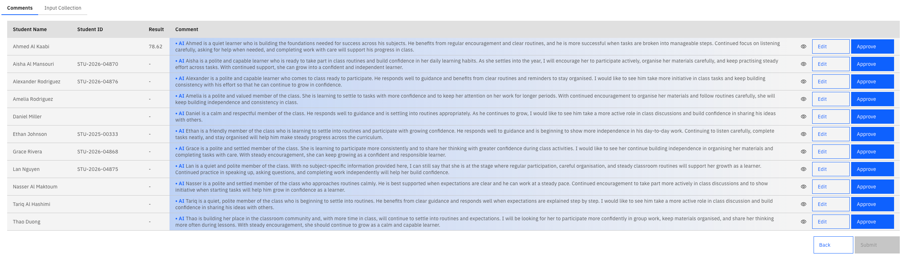
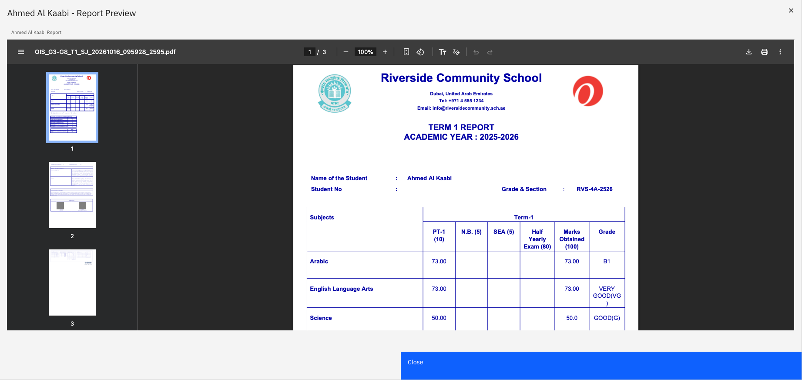

# Review and submit class comments

Artificial intelligence (AI) drafts a comment for each student. You check each one, change
anything that needs it, and approve it before submitting the class.

1. Open the report from your notification

   When the comments are ready, you get a notification. Click it to open the
   **Comments Review** page for that report.

2. Open a class

   Click a class to start reviewing its comments.

3. Review and approve each comment

   Read each comment, make any needed changes, then approve it.

   

4. Preview the draft report for homeroom classes

   For a homeroom class, you'll also see an **eye** icon beside each student.
   Click it to preview the student's draft report.

   

5. Submit the class

   Once every comment is reviewed, click **Submit**. The submit button is enabled when all the comments are approved. The class shows as
   **Completed** on the admin's progress view. Carry on with any other classes
   still waiting for you.

Submitted comments then go through quality assurance (QA). If any are flagged, you'll be asked to
revise them — see [Revise comments flagged by QA](./14-revise-comments-flagged-by-qa.md).
