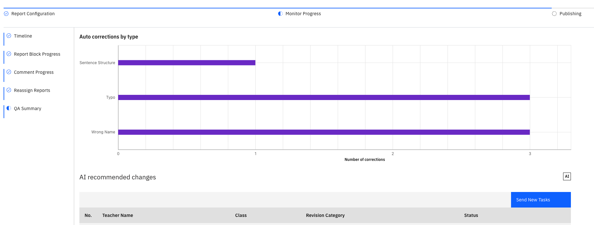

# Review the QA summary

{/* SOURCE — Academic Reporting Tool walkthrough video transcript
(AR_Video Transcript.docx, received 13 Oct 2026).
TO VERIFY: the exact labels of the send-all and send-individual actions; where QA
rules are configured (the transcript says "configured QA rules" but doesn't show
where); what the "insight sections" on the post-remediation page contain.
No screenshots available — add to ./images/ from a UAT build. */}

Every comment a teacher submits is checked by the **quality assurance (QA) agent** against your
school's QA rules. Simple errors are fixed automatically. Anything more is sent
back to the teacher as a revision task.

1. Start QA

   On the report's **Timeline**, execute **Reports ready for QA**. This starts the
   QA check on the comments teachers have reviewed and submitted. When it's done,
   execute **QA report ready**.

2. Open the QA summary

   When the QA milestones have updated, you get a notification. Click it to open
   **QA summary** or navigate to the **QA Summary** sub-tab.

3. Read the automatic corrections

   The bar chart counts the **Auto corrections by type**. These are errors
   the system could fix, and already has.

4. Review the recommended changes

   The **AI recommended changes** table lists the comments the QA agent has
   flagged for revision.

   

5. Send revision tasks

   Send all the new revision tasks to their teachers at once, or send an
   individual task to a specific teacher. Teachers then work through them — see
   [Revise comments flagged by QA](./14-revise-comments-flagged-by-qa.md).

6. Track the revisions

   Watch the table as task statuses update while teachers complete their
   revisions.

7. Close out QA

   The **QA remediation completion** milestone checks whether any comments still
   need revising. Once none do, it completes, and you and any human reviewers are
   notified. Click the notification to view the report's QA insights.
