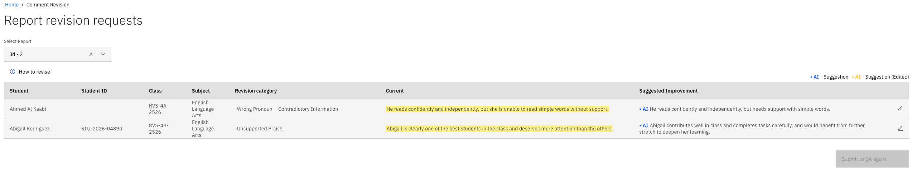
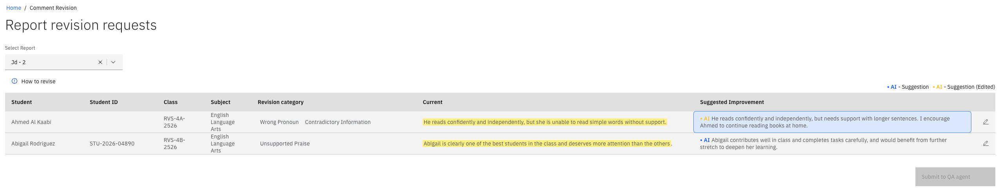

# Revise comments flagged by QA

When quality assurance (QA) flags one of your comments, it comes back to you as a revision task with
the problem highlighted and a suggested fix.

1. Open the revision page

   You get a **Revision Required** notification. Click it to open the **Comment
   Revision** page, which lists every comment waiting for you to revise.

2. See what was flagged

   In the **Current** comment column, the text with errors is highlighted. The
   QA agent also offers a **Suggested Improvement** to correct them.

   

3. Edit the improvement, if needed

   Change the suggested improvement as much as you need, such as by adding a
   sentence or adjusting the wording. When you edit a comment, the artificial intelligence (AI) icon turns
   **yellow** to show it's been changed by a person.

   

4. Submit for a recheck

   Select the revised version and submit it for a QA recheck. If it still has
   errors, the result comes back straight away on the same screen. Keep revising
   until every comment passes.
