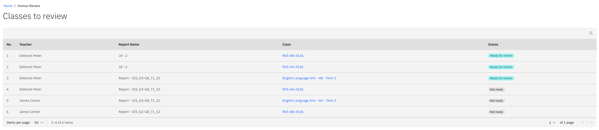

# Complete a human review

{/* SOURCE — Academic Reporting Tool walkthrough video transcript
(AR_Video Transcript.docx, received 13 Oct 2026).
TO VERIFY: whether a reviewer's edits go back through QA.
No screenshots available — add to ./images/ from a UAT build. */}

If the admin has assigned you as a **Human reviewer**, you get a final look at
the comments for your classes after quality assurance (QA), before the reports are published.
Reviewers are assigned during setup — see
[Configure the report process](./04-configure-the-report-process.md).

1. Open the human reviewer page

   When QA is complete, you get a notification. Click it to open the **Human
   reviewer** page, which lists the classes assigned to you for that report.

   

2. Open a class that's ready

   You can start on a class once its status is **Ready for review**. Open it to
   see the student list and their comments.

3. Edit comments, if needed

   Read the comments and make any needed changes.

4. Submit the class

   When you've finished, click **Submitted**. The class status changes to
   **Reviewed**.

Once every reviewer is done, the admin executes the **Human review completed**
milestone, which checks that all review tasks are finished and notifies the admin.
