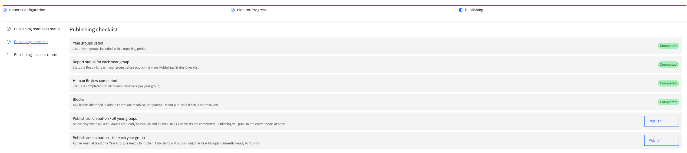
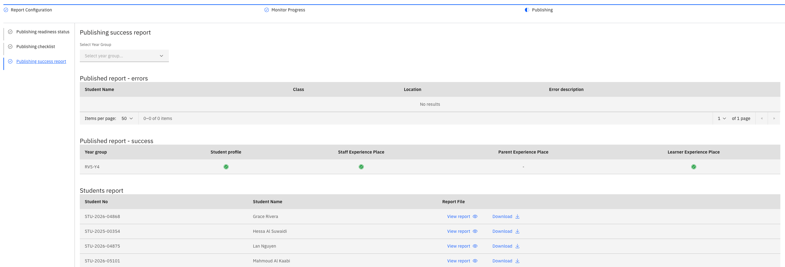

# Publish reports

**Ready to publish** is the last milestone. It checks that everything the report
needs is in place before you publish the reports to students.

1. Check the report is ready

   On the report's **Timeline**, execute **Ready to publish**. It checks every
   condition that must be met before the reports can be published.

2. Open the publishing checklist

   Go to the **Publishing** tab, select the **Publishing readiness status** sub-tab, then
   select **Publishing checklist**. It lists every requirement and whether it's
   met.

   

3. Fix anything incomplete

   If an item isn't met, **Ready to publish** stays incomplete on the timeline.
   Resolve the issue — for example, open report blocks are resolved on the report
   block page (see [Manage report blocks](./07-manage-report-blocks.md)) — then
   execute **Ready to publish** again.

4. Publish

   When every requirement is met, go to the **Publishing checklist** sub-tab; the **Publish** button on the checklist is
   enabled. Click **Publish**, then confirm in the pop-up. The system starts
   publishing the reports.

   > **Note:** Once you confirm, the reports go out. Check the checklist and the
   > comments are final before you publish.

5. Check what was published

   Go to the **Publishing success report** sub-tab to see the publishing status. You can
   view or download each student report that was published successfully.

   
