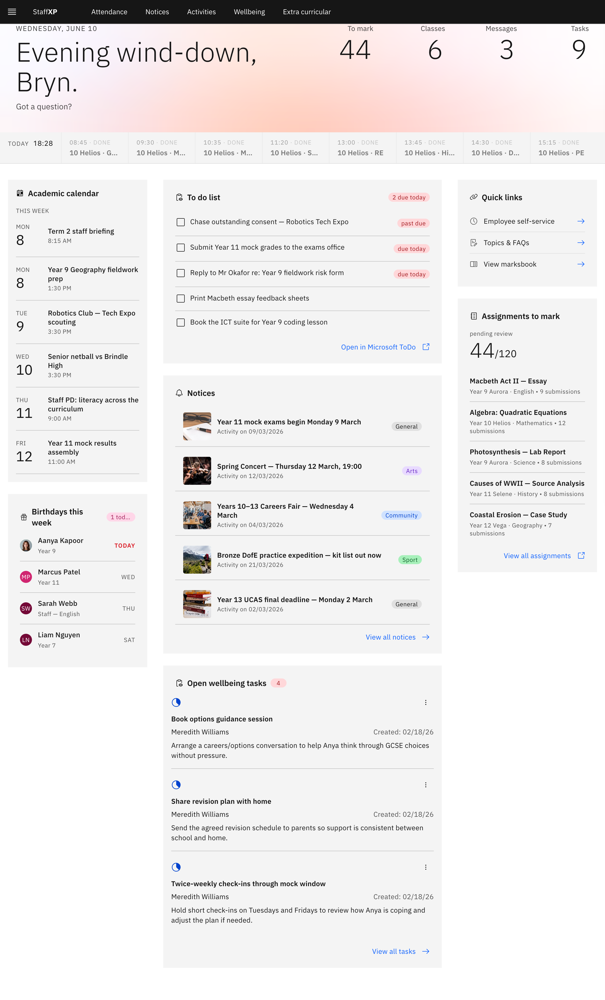

# StaffXP Help

The **Staff Experience Place, StaffXP** is your day-to-day hub for school tasks — attendance, notices, wellbeing,
activities, reporting, and more, all in one place. Find help by topic below, use the search
bar up top, or ask **Felix**, the in-app assistant.

## Browse by topic

- **[Navigating the platform](./02-Navigating/01-sign-in.md)** — sign in, find
  your way around the nav bar, your MyDay home page, themes, and settings.
- **[Attendance](./03-Attendance/01-use-attendance-page.md)** — take the daily
  roll (on the page or through Felix), view analytics, run emergency rolls, and
  (for leaders) the whole-school view.
- **[Notices](./04-Notices/01-find-and-read-notices.md)** — read the noticeboard,
  follow the categories you care about, RSVP to events, and create and manage
  notices.
- **[Activities](./05-Activities/01-open-activities-overview.md)** — plan
  excursions, camps, visits and trips, and book venues and resources against a
  shared calendar.
- **[Extra-curricular](./06-Extracurricular/01-browse-extracurricular.md)** —
  browse, request, and run extra-curricular activities, tracked on a calendar.
- **[Wellbeing](./07-Wellbeing/01-view-wellbeing-landing.md)** — create and track
  wellbeing notes, tasks and cases, with category trends.
- **[Notifications](./08-Notifications/01-check-notifications.md)** — your
  messages and alerts.
- **[Student & parent profiles](./09-Profiles/01-find-student-profile.md)** —
  look up student and parent information.
- **[AI & Felix](./10-AI/01-how-felix-agents-work.md)** — what Felix can do for
  you, how to prompt it, and the rewards dashboard.
- **[Academic reporting](./11-Academic-reporting/01-how-academic-reporting-works.md)** — set up and run a
  report cycle, enter grades, review and revise the drafted comments, and publish student reports.
- **[Troubleshooting](./12-Troubleshooting.md)** — common problems and how to
  resolve them.
- **[Glossary](./13-Glossary.md)** — the terms used across StaffXP.

## New here?

Start with **[your MyDay home page](./02-Navigating/03-myday-home.md)** — it pulls
the day's essentials together. Then dip into each topic as you need it, or just
ask Felix — see **[How Felix and the AI agents work](./10-AI/01-how-felix-agents-work.md)**.
